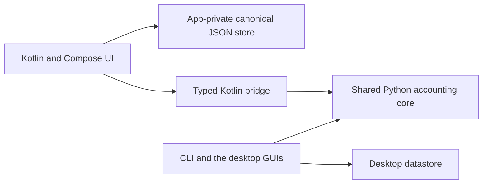

# Use or Lose for Android

The phone app for Use or Lose. It shares the desktop accounting core, keeps its working data in private desktop-compatible JSON, and reaches reports through native Compose screens. This directory is the Android Gradle root and the home of the phone specification, implementation briefs, fixtures and evidence.

## Status

The product specification, acceptance plan, orchestration rules and the first implementation briefs are complete. I01 has landed: `android/` is a working Gradle project with the single `app` module, pinned toolchain, launch screen and device smoke test. Open the directory in Android Studio to work on it.

| Track | State |
| --- | --- |
| Product specification and parity | Specification v1.3 (November 26, 2026: internal-identifier rename). Menu review approved November 23, 2026 |
| Orchestration specification | Complete; OR01 pilot not started |
| Implementation briefs | I01–I08 complete; next is I09 (history and corrections) |
| Android project | I08 complete — day editing (group editor, save review with exact IDs, add entry, editor resume after setup). 56 unit and 87 device tests pass; visual loop PASS on every screen through I08 |
| Fixtures | Calendar 2026 store, Carryover source, Editable day store, golden outputs, malformed-store variants and the marker overlap fixture under `qa/` (builder emits each; digests pinned in the per-fixture manifests) |

Keep this file current. Each milestone replaces planned commands and toolchain values with the tested values from its report.

## Open and run in Android Studio

Step-by-step, verified on this host (Ubuntu x86-64). The project is pre-Play maturity (I08 of I20): it opens, builds and runs in the emulator today, but release builds, signing and Play uploads belong to I19/I20.

### 1. One-time prerequisites

1. **Android Studio** — install the current stable release from developer.android.com (this host used the latest Hedgehog-series stable; any recent stable works).
2. **JDK 21** — Gradle runs on JDK 21. On Ubuntu: `sudo apt install openjdk-21-jdk`. Studio bundles its own JBR, but the pinned Gradle commands below use `JAVA_HOME=/usr/lib/jvm/java-21-openjdk-amd64`.
3. **Emulator support** — install a system image for your host architecture (API 36, `google_apis`, `x86_64` on this host) and enable hardware virtualization (KVM on Linux: `ls /dev/kvm`).

### 2. Open the project

1. Check out the repository: `git clone https://github.com/joshua-guthrie/use-or-lose.git`.
2. In Android Studio: **File → Open…** and select the **`android/` directory**, not the repository root. `android/settings.gradle.kts` is the Gradle root; Studio discovers the single `app` module.
3. Wait for the first Gradle sync (it downloads the pinned toolchain). If Studio asks to create `local.properties` or install SDK components, accept — `local.properties` is git-ignored and machine-specific.
4. If sync complains about the SDK location: **Settings → Languages & Frameworks → Android SDK** and point it at your SDK directory (this host: `~/Android/Sdk`).

### 3. First build

From a terminal inside `android/` (or the Studio terminal):

```bash
export JAVA_HOME=/usr/lib/jvm/java-21-openjdk-amd64
export PATH="$PWD/../.venv/bin:$PATH"   # Chaquopy's host Python must match the app's Python 3.13
./gradlew :app:assembleDebug
```

The first build creates the local Python venv only if it doesn't exist — the repository's `.venv` is the pinned one. If you built nothing before, the desktop venv lives at the repository root and the build just uses it.

### 4. Run the app in the emulator

The app's frozen-clock developer config and the pinned fixtures are wired for the test harness; a plain interactive run starts from an **empty store** and walks the real first-use flow (Welcome → Set up leave year → Calendar).

1. **Create the development AVD** (name, device and profile are pinned so tests and captures match):
   - Android Studio: **Device Manager → Create Virtual Device** → *Pixel 5* → system image **API 36, google_apis, x86_64** → name it **`fedleave_test`**.
   - Or from the terminal: `avdmanager create avd -n fedleave_test -k "system-images;android-36;google_apis;x86_64" -d pixel_5`.
2. **Boot it** (from a terminal; stop the Gradle daemon first on memory-constrained hosts like this one):
   ```bash
   ./gradlew --stop
   ~/Android/Sdk/emulator/emulator -avd fedleave_test -no-window -no-audio -no-boot-anim -gpu swiftshader_indirect &
   ```
   Wait until `adb shell getprop sys.boot_completed` prints `1`.
3. **Run the app**:
   - In Studio: select the `app` configuration and the booted device, press **Run ▸**.
   - Or from the terminal: `./gradlew :app:installDebug && adb shell am start -n com.westmouthbay.useorlose/.MainActivity`.
4. **What you'll see**: the Welcome screen (**Set up leave year**; Restore backup arrives in I17). Walk the setup (start-of-year or Today balances; carryover appears when a prior year exists) and land on the Calendar. Tap a day for the read-only day route and **Edit activity / Add entry** for the I08 editor.
5. **See the fixture data instead of an empty store**: the pinned fixtures (Calendar 2026, Carryover, Editable day) are imported by the connected tests, not by the interactive app. Run the device suite to exercise them end-to-end, or `adb pull` the app-private store after a test run (`android/qa/pull-evidence.sh`) to inspect the exact bytes.

### 5. Run the tests

```bash
./gradlew :app:testDebugUnitTest       # JVM unit tests
./gradlew :app:connectedDebugAndroidTest   # device tests on the booted fedleave_test AVD
```

Device evidence screenshots land in the app files dir; refresh the local copies with `android/qa/pull-evidence.sh` after each run (keep `android.injected.androidTest.leaveApksInstalledAfterRun=true` in `gradle.properties`).

## Compile and test## Compile and test

Run from `android/` with `JAVA_HOME` pointing at the pinned JDK and the repository virtual environment on `PATH` (Chaquopy's host Python must match the app's Python 3.13). On Windows use `gradlew.bat` for the same tasks. All of these passed in I01 and I02:

```bash
export JAVA_HOME=/usr/lib/jvm/java-21-openjdk-amd64
export PATH="$PWD/../.venv/bin:$PATH"
./gradlew --version
./gradlew :app:assembleDebug :app:testDebugUnitTest :app:lintDebug
./gradlew :app:connectedDebugAndroidTest
./gradlew :app:bundleDebug
```

The connected test needs a booted emulator or a phone. On this machine, stop the Gradle daemon before starting the emulator to avoid memory pressure:

```bash
./gradlew --stop
~/Android/Sdk/emulator/emulator -avd fedleave_test -no-window -no-audio -no-boot-anim -gpu swiftshader_indirect &
```

Run the shared desktop core checks from the repository root. These work today:

```bash
QT_QPA_PLATFORM=offscreen .venv/bin/python -m pytest -q
make quality          # Ruff format/check and scoped strict mypy
make test             # behavior suite
make package          # Python sdist and wheel
```

Rebuild the pinned Android fixtures instead of editing them by hand:

```bash
.venv/bin/python android/qa/fixtures/build_calendar_fixture.py
```

The builder prints the fixture tree digest. It must stay `03e9e1757f73015b356b900703a13a88390e854f274c7bce78bd2f9f00c7aea9`; see [the manifest](qa/fixtures/calendar-2026.manifest.json). The builder also emits the marker overlap fixture under `qa/fixtures/marker-fixture/` (digest `d60bd8d0…`, manifest `qa/fixtures/calendar-markers.manifest.json`). Device evidence captures land in the app files dir during the connected suite; keep `android.injected.androidTest.leaveApksInstalledAfterRun=true` and refresh them with `android/qa/pull-evidence.sh` after every run so the local evidence always matches the latest build.

Release builds, signing, Play uploads and device release rehearsal belong to I19 and I20. Do not commit `local.properties`, keystores, APKs, AABs or machine-specific SDK paths. [Google Play delivery](specification/chapters/06-delivery/06-01-google-play.md)

## Architecture



| Layer | Responsibility | Governing design |
| --- | --- | --- |
| Compose UI | Screens, navigation, accessibility, view state, lifecycle, clock injection, chart rendering, Sharesheet and document picker. | [Calendar](specification/chapters/01-calendar/01-01-main-screen.md) and [Reports](specification/chapters/03-reports-data/03-02-report-screens.md) |
| Kotlin bridge | One typed in-process interface to the Python core: `app/src/main/java/com/westmouthbay/useorlose/core/` (`CoreBridge`, `CoreModels`, `CoreError`, `TimeSource`, `AppDependencies`) over the Chaquopy module `useorlose_probe`. Writes go through `CreationBridge`/`EditingBridge`, thin request adapters over the same shared pure core the CLI uses (`cross_year.manual_ledger`/`derive_carryover`, `editing.replace_day_group`/`append_entry`, `ledger.create_transaction`) — no duplicated accounting code. The Calendar state machine lives in `.../calendar/` (`CalendarViewModel`, `CalendarUiState`, `CalendarDisplaySettings`), the screens in `calendar/` and the navigation host in `ui/`. | [Core and compatibility](specification/chapters/04-architecture/04-01-core-and-compatibility.md) |
| Shared Python core | Accounting rules, eligibility, accrual, leave-year boundaries, carryover, lots, parental windows, report inputs. Lives in the repository's root `src/`. | [Responsibilities and data flow](specification/chapters/04-architecture/04-01-core-and-compatibility.md#responsibilities-and-data-flow) |
| Private store | Canonical `config.json`, `leave_years/<year>.json` and `holiday_cache/*.json` in internal no-backup storage. One serialized writer, immutable read snapshots, candidate validation and generation recovery. | [Device storage](specification/chapters/04-architecture/04-02-device-storage.md) |
| Desktop | Existing CLI and GUI entry points remain the compatibility baseline and share the same accounting rules and datastore schema. | [Architecture](../docs/ARCHITECTURE.md) |

The shared core is pure standard-library Python — no pydantic or compiled dependencies — and runs identically on Linux, Windows and Android.

Rules that every change must respect:

- Reads use an immutable snapshot. Previews and confirmations share a fingerprint; a changed store forces a new review.
- One writer publishes complete candidate generations. A crash leaves the prior or new complete store, never a partial one.
- The phone is offline-first. No terminal, MCP, AI, Qt or desktop chart packages enter the Android dependency graph.
- Calendar PDF and report sharing are user-initiated Sharesheet handoffs. Printing is out of scope.
- The canonical store stays desktop-compatible; restore is the only inbound file workflow.

## Repository organization

| Path | Contents |
| --- | --- |
| `specification/specification.md` | Product scope, pinned desktop reference and chapter index |
| `specification/chapters/` | Normative requirements, screens, architecture, quality and delivery |
| `specification/verification/` | Feature parity matrix, acceptance cases, fixtures and exact outcomes |
| `specification/passdowns/` | Numbered specification-writing checkpoints |
| `implementation/briefs/` | One self-contained execution brief per bounded task |
| `implementation/passdowns/` | Coding-milestone handoffs once implementation starts |
| `settings.gradle.kts`, `gradle/`, `gradlew` | Android Gradle root and pinned wrapper (created by I01) |
| `app/` | Kotlin, Compose, resources, manifest, JVM and device tests (created by I01) |
| `bridge/` | Optional Android-specific Python packaging module if I02 needs it |
| `qa/fixtures/` | Synthetic input stores, the fixture builder and defect variants |
| `qa/golden/` | Expected desktop-derived outputs used by bridge and core tests |
| `qa/evidence/`, `qa/reports/` | Screenshots, logs and the per-milestone QA gate report |
| `reviews/code/` | Separate AI code review for each candidate |
| `deliverables/` | Release notes, artifact manifests and Play Console evidence |

The full ownership rules are in [Project organization](specification/chapters/07-organization/07-01-project-organization.md).

## Documentation map

| If you want to… | Start here |
| --- | --- |
| Read the phone behavior and designs | [Specification index](specification/specification.md) |
| Pick or resume implementation work | [Milestones](specification/chapters/06-delivery/06-02-implementation-milestones.md) · [Briefs](implementation/briefs/README.md) · [Root passdown](../passdown.md) |
| Check desktop coverage and exact expected values | [Feature parity](specification/verification/feature-parity.md) · [Acceptance tests](specification/verification/acceptance-tests.md) |
| Verify or review a candidate | [QA gates](specification/chapters/05-quality/05-02-quality-gates.md) · [QA template](qa/reports/template.md) · [Review template](reviews/code/template.md) |
| Plan a model handoff or the offline pilot | [Orchestration index](specification/orchestration.md) |
| Find release identities and storage conventions | [Deliverables](deliverables/README.md) · [Project organization](specification/chapters/07-organization/07-01-project-organization.md) |
| Follow repository rules for commits and publication | [AGENTS.md](../AGENTS.md) |

## Keeping this README current

Update this file in the same change whenever setup, build or test commands, toolchain versions, architecture, or directory layout changes. Each milestone closeout checks it; I01 replaces the placeholder toolchain, and I02 records the final bridge module and runtime. Do not leave stale instructions for a future milestone that has already landed.
