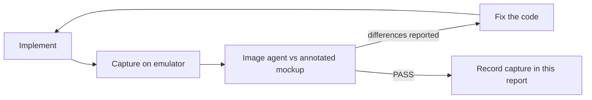
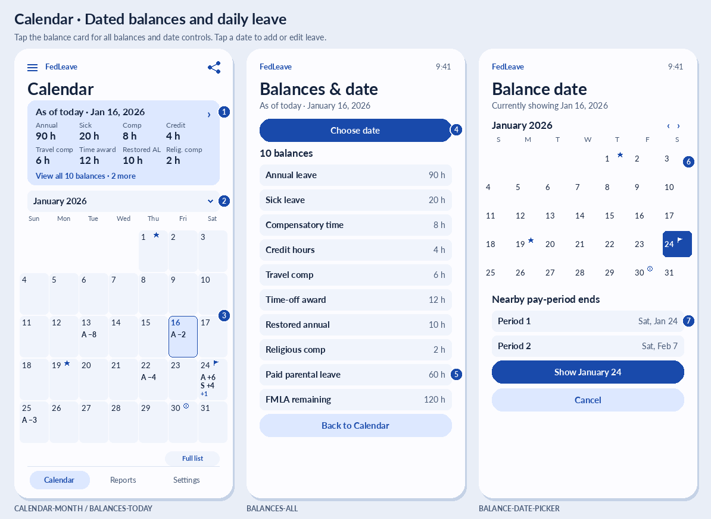
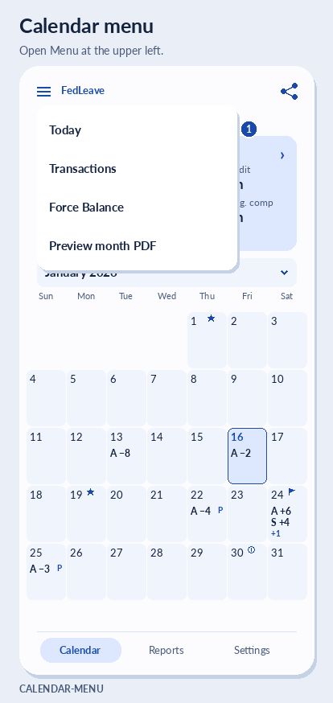
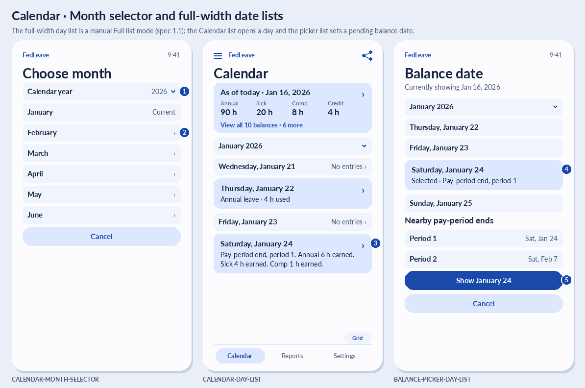
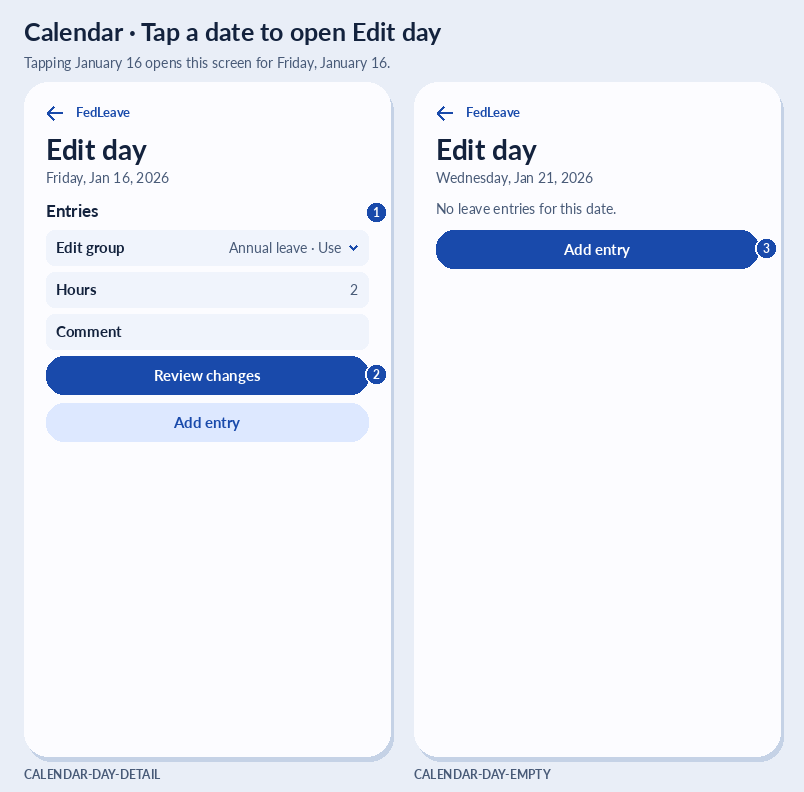
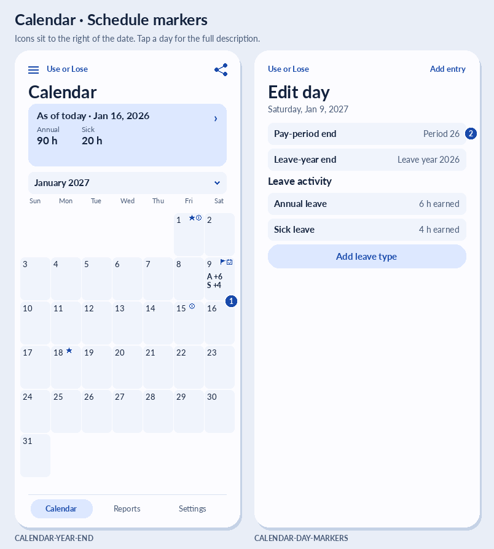

# QA report for milestone I05-02

## Candidate and scope

| Item | Evidence |
| --- | --- |
| Status | Pass |
| Spec revision and approved decisions | Specification **v1.1** (November 24, 2026): owner revision of the Calendar grid — uniform stretched cells, fixed-size grid text, manual **Full list** mode, scroll instead of clip. Prior decisions: checkpoint 31 (I01–I06 approval), mockup-conformance and synthetic-evidence rulings |
| Code revision, build ID and source identity | `dbe9508` + review fixes `a44da67` + owner grid revision `8cfebea`; fixture digests unchanged: calendar-2026 `03e9e175…`, calendar-markers `d60bd8d0…` |
| Implementation brief, starting revision, and preflight results | [I05 brief](../../implementation/briefs/I05-calendar.md) task I05-02; preflight: I05-01 state machine and adapter evidence passed on the parent |
| Package, check policy and isolation result, when delegated | Not delegated |
| Affected requirements, acceptance and screen IDs | I05-02 "Calendar, navigation, and markers" row; `T-CAL-BAL-01/05`, `T-CAL-NAV-01`, `T-CAL-MARK-01`, `T-CAL-MENU-01` at screen level; screens CALENDAR-MONTH, BALANCES-TODAY, CALENDAR-MENU, CALENDAR-MONTH-SELECTOR, CALENDAR-DAY-LIST, CALENDAR-YEAR-END, CALENDAR-DAY-MARKERS, CALENDAR-DAY |
| Device, API, density, font scale, theme and locale | Emulator `fedleave_test` (pixel_5), Android 16 (API 36), `x86_64`, 1080x2340 @ 440 dpi; default, dark (night) and 2x font-scale states captured |
| Fixture revision, checksum and fixed clock | Calendar 2026 fixture + marker fixture (`qa/fixtures/marker-fixture/calendar-markers/`, generated by the pinned builder); frozen clock 2026-01-16 |
| Commands, CI run and evidence location | Commands below; no CI run (local only); captures under `qa/evidence/I05-02/` |
| Separate AI code review report | [I05-02 review](../../reviews/code/I05-02.md) |

## Checks on the final candidate

From `android/` with `JAVA_HOME=/usr/lib/jvm/java-21-openjdk-amd64` and the repository `.venv/bin` on `PATH`:

```bash
./gradlew :app:assembleDebug :app:testDebugUnitTest :app:lintDebug   # 35/35 unit tests
./gradlew :app:connectedDebugAndroidTest                              # 40/40 device tests
```

| Requirement and case | Expected | Observed | Status | Evidence |
| --- | --- | --- | --- | --- |
| Launch and Today (01/05) | Calendar opens on the fixture date with the card "As of today · Jan 16, 2026" (Annual 90 h, Sick 20 h); Menu > Today restores month and cutoff | Verified on screen; Menu > Today resets February → January with 90/20 | Pass | `cardShowsTodayHeaderAndFixtureBalances`, `menuDismissalPreservesStateAndTodayResets` |
| Menu (MENU-01) | Anchored dropdown with only Today; dismissal by outside tap and system Back preserves month and cutoff | Outside-tap and Back dismissal verified with real window-level input; only Today present | Pass | `menuDismissalPreservesStateAndTodayResets` |
| Month selection (NAV) | Choose month changes the grid and preserves the cutoff; January 2027 browses the 2026 ledger | Month picker selects months and years; year choices extend one year beyond stored years; cutoff untouched | Pass | `monthPickerSelectsAMonthAndPreservesTheCutoff`, marker-suite browsing |
| Day route (NAV, read-only) | Edit day opens with date, events and activity; Back preserves month, cutoff, scroll and tapped-day focus | Read-only route verified for Jan 16 (2 h used), empty day and Jan 9 2027 (four events); scroll and selected day restored on Back | Pass | `tappingADayOpensTheReadOnlyDayRouteAndBackPreservesCutoff`, `emptyDayShowsNoEntries`, `dayRouteNamesTheJanuary9EventsAndLeavesTheCutoffUntouched` |
| Markers (MARK-01) | Four 9 dp glyphs in table order right of the date, two per row; January 9 2027 carries all four events; spoken order date → events → activity | Glyphs inline with the date; Jan 9 2027 shows star, coin, flag and checked calendar with A +6 / S +4; exact TalkBack descriptions asserted; hidden-holiday flag removes only the holiday description | Pass | `january2026GridShowsTheMarkerFixtureSchedule`, `january9_2027CarriesAllFourEventsTogether`, `CalendarMarkerFlagsTest`, `gridShowsMarkersAndActivityLines` |
| Grid layout (spec 1.1) | Uniform cell height filling the space between the month selector and the bottom bar; fixed-size grid text at large system font; manual Full list toggle; scroll instead of clip | Verified by measurement (all cells 235 px on the reference device) and by the image agent; toggle test passes; 2x capture shows the fixed-size grid with unclipped amounts | Pass | `fullListToggleSwitchesBetweenGridAndList`, `narrowWidthFallsBackToTheDayList`, captures below |
| Bottom tabs | Three mockup tabs; Reports/Settings open placeholder destinations; Calendar restores | Verified | Pass | `bottomTabsOpenPlaceholdersAndReturnToCalendar` |
| Regression | I01–I05-01 suites unaffected | Unit 35/35; device 40/40; lint and assemble pass; store suites order-independent | Pass | Build logs |

## Visual comparison — the mockup loop with the final captures

The loop ran five iterations: implement → capture → image-agent comparison → fix the code → recapture, until the capture matched the mockup (the code changes, never the mockup). All captures are stored under `qa/evidence/I05-02/`.



### CALENDAR-MONTH / BALANCES-TODAY

| Annotated mockup (regenerated for spec 1.1) | Final app capture |
| --- | --- |
|  |  |

**PASS** — balance card, month pill, inline markers on 1/19/24/30, outlined today, activity lines, uniform stretched cells filling the space above the **Full list** pill.

### CALENDAR-MENU

| Annotated mockup | Final app capture |
| --- | --- |
|  |  |

**PASS** — white panel, tight corners, anchored under the hamburger covering the heading, only **Today** (interim state).

### CALENDAR-MONTH-SELECTOR

| Annotated mockup | Final app capture |
| --- | --- |
|  |  |

**PASS** — year chip row with a plain chevron, twelve month chips with **Current** on January, pinned Cancel pill.

### CALENDAR-DAY-LIST (manual Full list mode, spec 1.1)

| Annotated mockup | Final app capture |
| --- | --- |
|  |  |

**PASS** — day cards with the date above the body, event labels spelled out ("Holiday, New Year's Day"), trailing chevrons, **Grid** toggle to return.

### CALENDAR-DAY (read-only day route)

| Annotated mockup | Final app capture |
| --- | --- |
|  |  |

**DIFFERENCES (recorded, not defects):** the heading reads **Leave activity** (the two day-route boards disagree; the markers board's wording was kept, owner-confirmed good with either); the mockup's edit controls are absent by I05 scope; the activity row is a light pill with "2 h used".

### CALENDAR-YEAR-END (January 2027 collision)

| Annotated mockup | Final app capture |
| --- | --- |
|  |  |

**PASS** — blank leading cells, all four glyphs on Jan 9 in table order, A +6 / S +4 beneath, last row without February dates.

### CALENDAR-DAY-MARKERS (January 9, 2027)

| Annotated mockup | Final app capture |
| --- | --- |
|  |  |

**PASS** — event pills (Holiday, Payday, Pay-period end / Period 26, Leave-year end / Leave year 2026) and the activity pills (Annual 6 h earned, Sick 4 h earned).

### Dark theme and large text

| Dark theme | Large text (grid stays, fixed-size text, spec 1.1) |
| --- | --- |
|  |  |

**PASS / PASS** — dark: markers and amounts legible with theme contrast; large text: the grid keeps its base size (amounts unclipped) while the surrounding chrome scales.

### Iteration log

| Iteration | Findings reported by the image agent | Fix applied |
| --- | --- | --- |
| 1 | ANR dialog dimming every capture; marker glyphs possibly invisible; wrong-screen day capture; menu inset; month-row styling; bottom-bar pill; left-flush activity line; dark card values invisible | Disabled Digital Wellbeing; fixed zero-size glyphs (9 dp modifier); waited for displayed states; menu offset; pill row; transparent unselected tabs; line padding |
| 2 | System UI ANR swallowing window-level input; trailing-period test strings matched nothing (this Compose version reports zero matches as "not displayed"); narrow-list rows below the fold; unstyled picker rows | UIAutomator ANR dismissal + `hide_error_dialogs`; corrected strings; scroll-to-node; chip rows + pinned Cancel |
| 3 | Markers on a second line; filled instead of outlined selection; flat cells; mauve menu surface (M3 default container); filled year-row caret; missing blank grid cells; dark glyph contrast; clipped large-text amounts | Inline markers; outlined today; tile fills; neutral `surfaceContainer*` tokens; plain chevrons; in-month-only cells; theme-derived glyph colors |
| 4 | Day-list date column squeezed at 2x; inline chevron; date text hierarchy | Card layout (date above body), trailing chevron, `onSurface` date |
| 5 | Owner revision (spec 1.1): cells must fill the space with one uniform height; grid text fixed at large font; manual Full list toggle; scroll instead of clip | Weighted stretch with a content threshold; fixed `fontScale` for the grid; toggle pill above the bottom bar; measured verification (all cells 235 px) + image-agent PASS |

Known-expected differences recorded against the mockups (not defects): the card shows the fixture's two real balances instead of the mockup's eight fictional values (layout double lands with I05-03); no Share icon until I15; no Transactions/Force Balance until I09/I10; no day-route edit controls until I08; the "+1" third line under Jan 24 needs the fictional comp entry (I05-03 test double); the marker fixture's paydays differ from the mockup board's illustrative coins; the bottom bar persists on all screens; annotation circles are mockup-only; the **Full list** pill is the spec 1.1 addition now rendered on the regenerated mockup boards.

## Findings, fixes, and retests

| Finding and affected ID | First failing candidate and evidence | Fix | Retested candidate | Case and regression results | Status |
| --- | --- | --- | --- | --- | --- |
| F1 · Required — day-list rows did not visibly spell out schedule events | `dbe9508`; independent review | Row body now prefixes the visible event labels with short-label activity in a card layout | `a44da67` | `narrowWidthFallsBackToTheDayList` asserts holiday and period-end row text; capture verified | Pass |
| F2 · Low — stale month/balance shown under a new key while loading | `dbe9508`; review | Loading indicators keyed to the request identity | `a44da67` | Browse and confirm paths exercised by the suite | Pass |
| F3 · Low — Back from the day route cleared the tapped-day selection | `dbe9508`; review | Selection kept; grid scroll and list position saveable-restored | `a44da67` | Day-route tests; manual Back verification | Pass |
| F4 · Low — navigation pin substitution unrecorded | `dbe9508`; review | Brief P-D4 records 2.9.8 + the AGP 9.1/compileSdk 37 rationale | `a44da67` | — | Pass |
| F5/F6 · Info — month-unavailable Retry wiring, tab semantics | `dbe9508`; review | Retry lands with I05-03; tab semantics queued for the accessibility pass | `a44da67` | — | Recorded |
| Owner grid revision (spec 1.1) — cells did not fill the space; 2x text clipped; unwanted automatic list switch | `a44da67`; owner review of the final captures | Weighted uniform stretch (threshold-tuned after measuring the real device); fixed grid font scale; manual toggle; scroll fallback | `8cfebea` | All cells measured equal (235 px); 40/40 device tests; image-agent PASS on all six checks | Pass |
| Mockup renderer — toggle pill size inconsistent between boards | Regenerated boards | Single width formula for the pill; boards re-rendered | `8cfebea` | Image-agent board check PASS | Pass |

## Completion gates

| Gate | Status | Evidence or applicability reason |
| --- | --- | --- |
| Spec and traceability | Pass | Spec **v1.1** records the owner grid revision with the changed chapters (01-01, 01-04), acceptance companion paragraph and regenerated mockup boards; every acceptance case links to this evidence. |
| Build and functional behavior | Pass | Unit 35/35, device 40/40, assemble and lint pass on the final candidate. |
| GUI conformance and accessibility | Pass | Five-iteration visual loop closed with the image agent on every affected screen and state; TalkBack descriptions asserted in tests; uniform-cell and fixed-text behavior verified by measurement and capture. |
| Data and platform behavior | Pass | Fixture digests pinned (builder rerun verified); reads leave the store untouched (I05-01 evidence); marker fixture generated only by the builder. |
| Code review and retest | Pass | [I05-02 review](../../reviews/code/I05-02.md) found one required finding; fixed and regression-tested; the owner grid revision was verified by the image agent and the measured-layout diagnostic. |
| Completion and release evidence | Not applicable | No source push to `master`; Distribution rules apply on the first push. |

Completion decision: **I05-02 is complete** on commit `8cfebea`, specification **v1.1**. Next action: I05-03, Balance detail and date selection, from the [I05 brief](../../implementation/briefs/I05-calendar.md) and the [I05-02 passdown](../../implementation/passdowns/I05-02.md).
