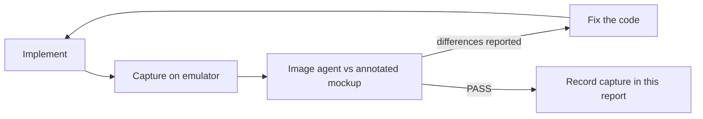
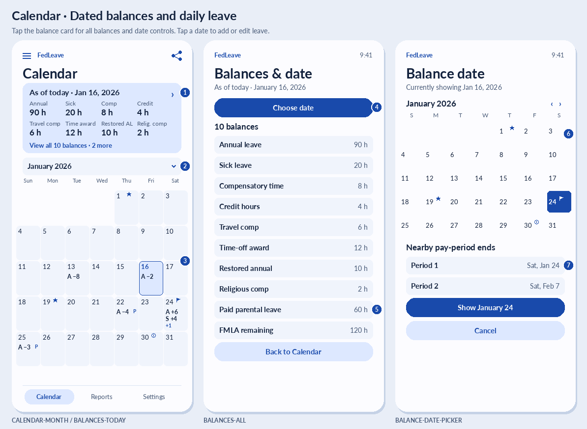
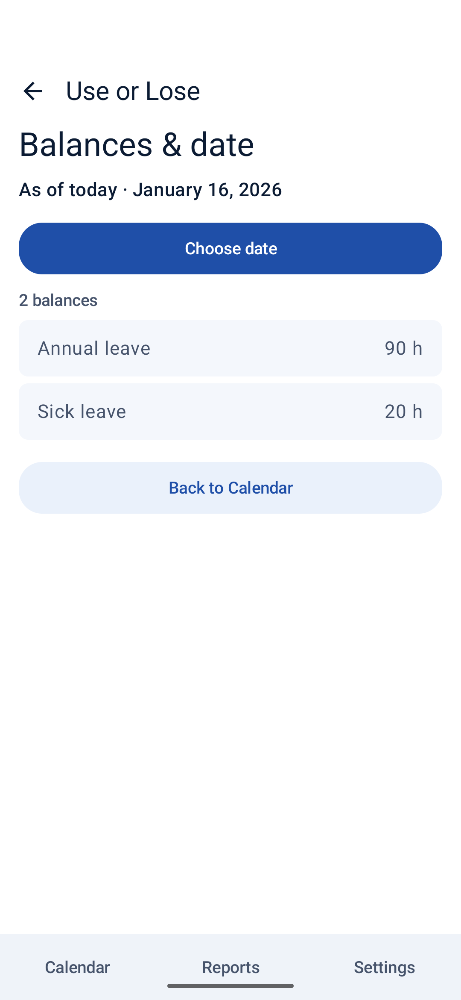
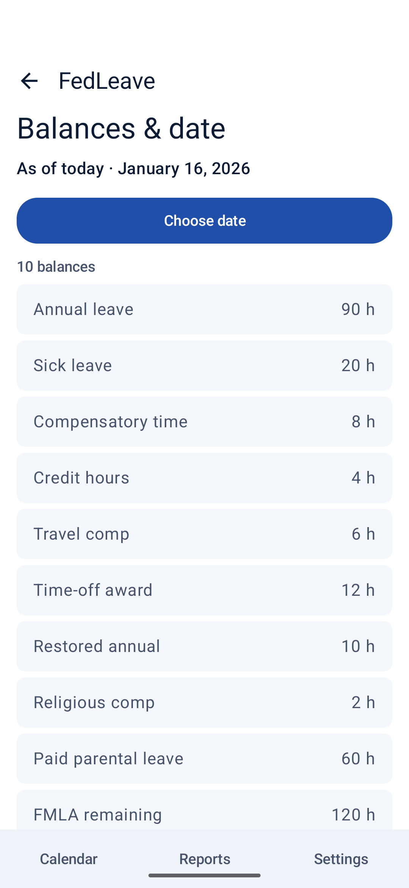
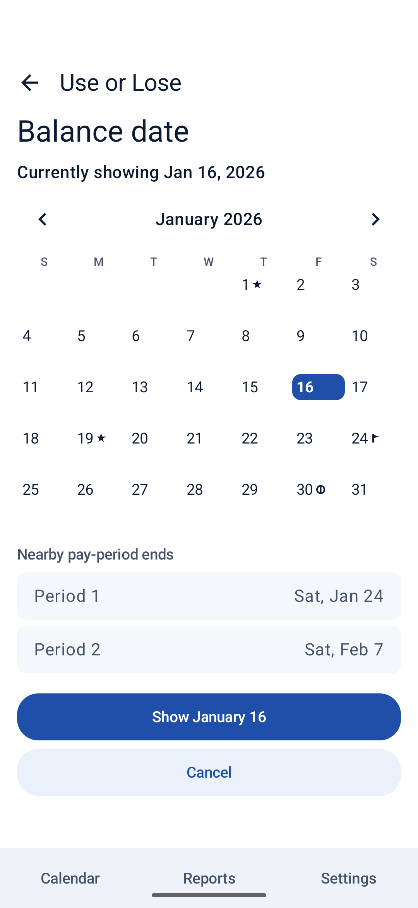
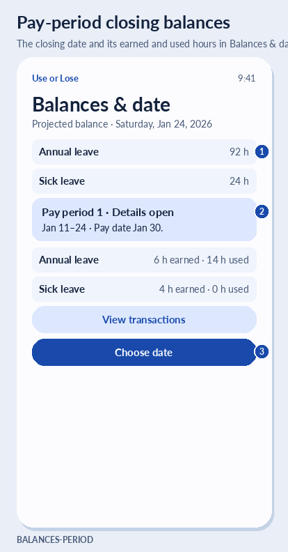
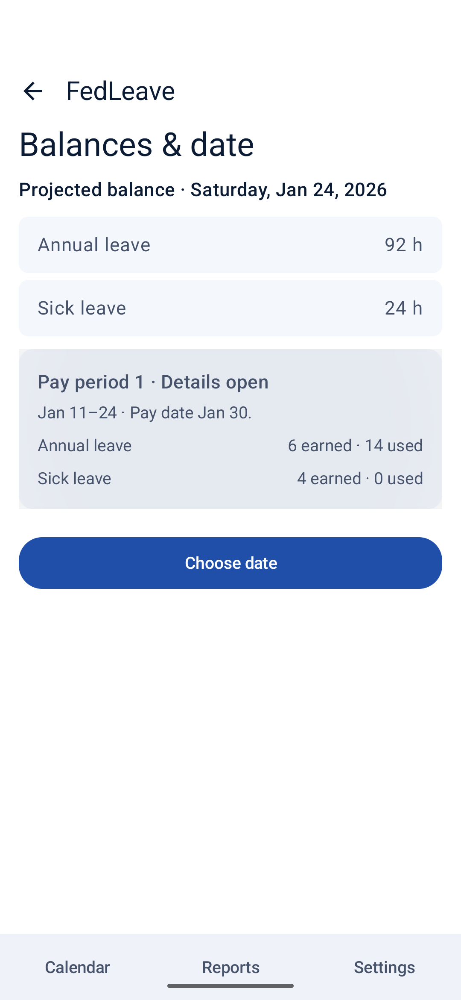
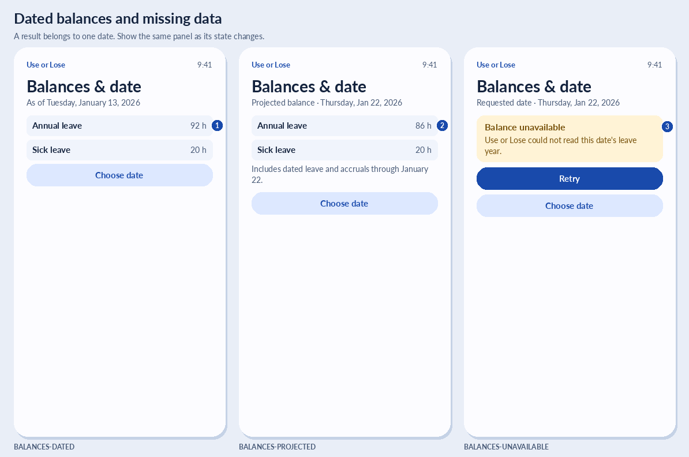
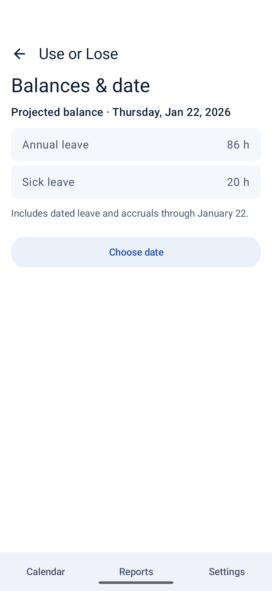
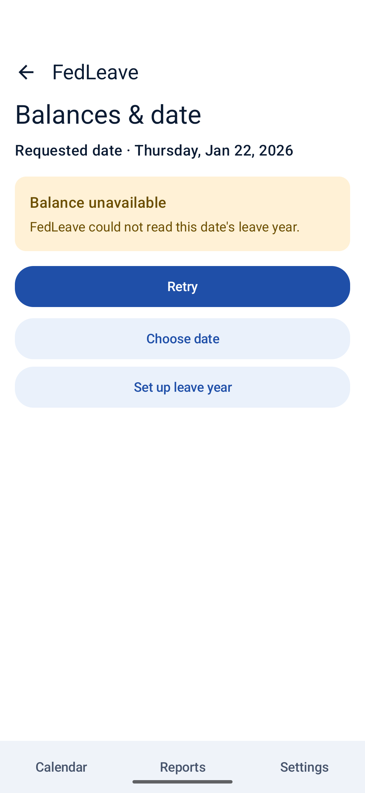

# QA report for milestone I05-03

## Candidate and scope

| Item | Evidence |
| --- | --- |
| Status | Pass |
| Spec revision and approved decisions | Specification v1.1; I05-03 task row of the [I05 brief](../../implementation/briefs/I05-calendar.md); owner mockup-conformance rulings |
| Code revision, build ID and source identity | `37021af` + review fixes `c1cd9fe`; fixture digests unchanged: calendar-2026 `03e9e175…`, calendar-markers `d60bd8d0…` |
| Implementation brief, starting revision, and preflight results | I05-03 "Balance detail and date selection" row; preflight: I05-01/I05-02 evidence passed |
| Package, check policy and isolation result, when delegated | Not delegated |
| Affected requirements, acceptance and screen IDs | `T-CAL-BAL-02/03/04/06/08`, `T-CAL-NAV-01`; screens BALANCES-ALL, BALANCE-DATE-PICKER, BALANCES-PERIOD, BALANCES-DATED, BALANCES-PROJECTED, BALANCES-UNAVAILABLE |
| Device, API, density, font scale, theme and locale | Emulator `fedleave_test` (pixel_5), Android 16 (API 36), `x86_64`, 1080x2340 @ 440 dpi |
| Fixture revision, checksum and fixed clock | Calendar 2026 fixture + marker fixture; frozen clock 2026-01-16 |
| Commands, CI run and evidence location | Commands below; no CI run (local only); captures under `qa/evidence/I05-02/` (the combined Calendar suite directory) |
| Separate AI code review report | [I05-03 review](../../reviews/code/I05-03.md) |

## Checks on the final candidate

From `android/` with `JAVA_HOME=/usr/lib/jvm/java-21-openjdk-amd64` and the repository `.venv/bin` on `PATH`:

```bash
./gradlew :app:assembleDebug :app:testDebugUnitTest :app:lintDebug   # 37/37 unit tests
./gradlew :app:connectedDebugAndroidTest                              # 67/67 device tests (combined Calendar suite)
```

| Requirement and case | Expected | Observed | Status | Evidence |
| --- | --- | --- | --- | --- |
| Card → full list (BAL-02/08) | Tap the card: Balances & date at the committed cutoff, full labels and values, Choose date, Back to Calendar | Verified with the real fixture (2 balances) and the ten-balance fake double | Pass | `cardOpensTheFullListForToday`, `tenBalancesPreviewWithHintAndFullList` |
| Preview and hint (BAL-08) | Eight of ten preview values plus "View all 10 balances · 2 more"; no hint at exactly eight; capacity-based columns | Verified on device (4 columns / 8 values, hint), large-text columns (2) and hint math unit-tested | Pass | `tenBalancesPreviewWithHintAndFullList`, `BalancePresentationTest` |
| Picker and shortcuts (BAL-03) | Picker at the committed cutoff; shortcuts Jan 24 / Feb 7; a shortcut outside the month moves the picker month; anchor stays stable | VM tests assert the anchor/shortcut contract; device asserts the rows and confirm flow | Pass | `pickerShortcutKeepsTheAnchorStableAndConfirmCommits`, `pickerLoadsItsOwnMonthAndReAnchorsShortcuts`, `pickerShowsShortcutsAndConfirmsAProjectedDateWithPeriodDetail` |
| Confirmation, cancellation, projection (BAL-02/04) | Confirm commits and projects future dates with the exact values; cancel preserves the committed date | Jan 24 → 92/24 projected + period detail; Jan 22 → 86/20 + explanation; Jan 13 → 92/20 dated; cancel keeps Jan 16 | Pass | `pickerShowsShortcutsAndConfirmsAProjectedDateWithPeriodDetail`, `projectedDateShowsTheExplanation`, `historicalDateShowsDatedResultWithoutProjection`, `cancelPreservesTheCommittedDate` |
| Period detail (BAL-03) | Collapsed pay-period card expands to number, Jan 11–24, Jan 30 pay date, 6/14 and 4/0 totals | Verified on device | Pass | Same tests |
| Unavailable and Retry (BAL-06) | Requested date with a failed read shows the warning card, Retry and Choose date; Retry recovers | Verified with the fake bridge (fail once, then recover) | Pass | `unavailableBalanceShowsRetryAndRecovers` |
| Overflow grid line (BAL-08 paragraph) | Three entries on Jan 24 → two lines + "+1"; the day route reveals all three | Verified with the comp-entry double | Pass | `gridShowsOverflowCountForThreeEntriesAndDayRouteRevealsThem` |
| Picker fallback and flags (MARK-01) | Narrow screens use the picker day list; the picker always marks pay-period ends even when the Calendar hides them | Verified by the narrow fallback test and `CalendarPickerFlagsTest` | Pass | `narrowWidthFallsBackToThePickerDayList`, `pickerStillMarksPeriodEndsWhenTheCalendarHidesThem` |
| Regression | I01–I05-02 suites unaffected | Unit 37/37; device 67/67; lint and assemble pass | Pass | Build logs |

## Visual comparison — the mockup loop with the final captures

Two iterations of implement → capture → image-agent compare → fix code → recapture; all six states now PASS.



| State | Annotated mockup | Final app capture | Result |
| --- | --- | --- | --- |
| BALANCES-ALL (today) |  |  | **PASS** — pill rows, Choose date at top, count heading, Back to Calendar |
| BALANCES-ALL (ten-balance double) |  |  | **PASS** — all ten pill rows with exact values |
| BALANCE-DATE-PICKER |  |  | **PASS** — single-letter weekday header, unfilled cells, filled draft, shortcuts, Show/Cancel |
| BALANCES-PERIOD |  |  | **PASS** — expanded period card with Jan 11–24 · Jan 30, totals, Choose date at the bottom |
| BALANCES-PROJECTED |  |  | **PASS** — exact subtitle, 86/20, explanation, secondary Choose date |
| BALANCES-UNAVAILABLE |  |  | **PASS** — cream warning card, exact subtitle, Retry + Choose date only |

Iteration 1 findings and fixes: rows were plain white instead of pale-blue pill cards; the count heading and Choose date/Back actions appeared on every state instead of the per-state arrangement in the mockups; the projected note appeared on the period state; the warning card was neutral instead of cream; the picker weekday header used three-letter labels and filled every cell; the unavailable subtitle spelled out the month. All fixed; iteration 2 verified PASS on every state.

Known-expected differences (not defects): the real-fixture list shows two balances instead of the mockup's ten fictional values; the picker capture shows the Jan 16 draft ("Show January 16") where the mockup board pictures Jan 24; no Share icon until I15; no "View transactions" until I09; the bottom bar persists; annotation circles are mockup-only.

## Findings, fixes, and retests

| Finding and affected ID | First failing candidate and evidence | Fix | Retested candidate | Case and regression results | Status |
| --- | --- | --- | --- | --- | --- |
| F1 · Required — the picker never rendered the narrow-screen day-list fallback | `37021af`; independent review | `PickerDayList` with the same row semantics and tags; picker switches on width like the Calendar | `c1cd9fe` | `narrowWidthFallsBackToThePickerDayList` (scroll-to-row, draft selection, Show label) | Pass |
| F2 · Low — previous picker month rendered under the new month header while loading | `37021af`; review | Loading state keyed to `pickerMonthFor != pickerMonth` | `c1cd9fe` | Full suite; picker flows | Pass |
| F3 · Low — system Back left the picker draft behind | `37021af`; review | `BackHandler` cancels before popping | `c1cd9fe` | Picker flows | Pass |
| F4 · Low — no test that the picker marks period ends when the Calendar hides them | `37021af`; review | Picker forces `showPayPeriodEnds = true` from the injected settings; new flags test | `c1cd9fe` | `pickerStillMarksPeriodEndsWhenTheCalendarHidesThem` | Pass |
| F5–F10 · Info — evidence dir consolidation, test substitution, plurals, retry wiring | `37021af`; review | Recorded here (see below); `balances_count` now a plurals resource | `c1cd9fe` | — | Recorded |

Recorded items: Calendar evidence intentionally consolidates under `qa/evidence/I05-02/` (the combined suite); the brief's `BalanceDatePickerStateTest` was delivered as the CalendarViewModel picker cases plus `BalancePresentationTest` (equivalent coverage); month/period retry UI and device-side store hashing remain queued with their milestones.

## Completion gates

| Gate | Status | Evidence or applicability reason |
| --- | --- | --- |
| Spec and traceability | Pass | Every I05-03 requirement and acceptance case links to the brief rows and this evidence. |
| Build and functional behavior | Pass | Unit 37/37, device 67/67 (combined Calendar suite), assemble and lint pass on the final candidate. |
| GUI conformance and accessibility | Pass | Two-iteration visual loop closed with the image agent; pill rows, per-state actions, warning color and picker states verified; TalkBack descriptions asserted. |
| Data and platform behavior | Pass | Fixture digests pinned; reads leave the store untouched (I05-01/I05-02 evidence); store hashing on JVM. |
| Code review and retest | Pass | [I05-03 review](../../reviews/code/I05-03.md) found one required finding; fixed and regression-tested. |
| Completion and release evidence | Not applicable | No source push to `master`; Distribution rules apply on the first push. |

Completion decision: **I05 is complete** — I05-01 (`ef58d56`, `77d0327`), I05-02 (`8cfebea`, spec v1.1) and I05-03 (`c1cd9fe`) with the combined Calendar acceptance cases (`T-CAL-BAL-01…08`, `T-CAL-NAV-01`, `T-CAL-MARK-01`, `T-CAL-MENU-01`) passing. Next action: I06, Open or create a leave year, from the [I05-03 passdown](../../implementation/passdowns/I05-03.md) and the [I06-02 brief](../../implementation/briefs/I06-02-today-balances.md).
