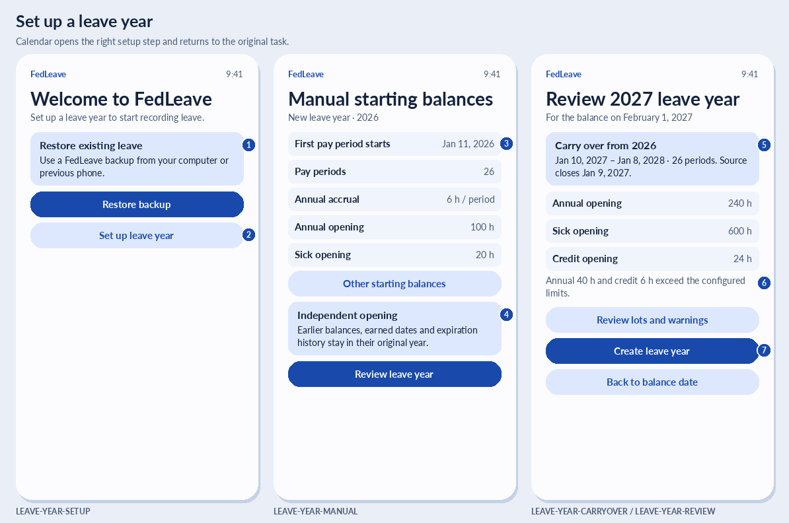
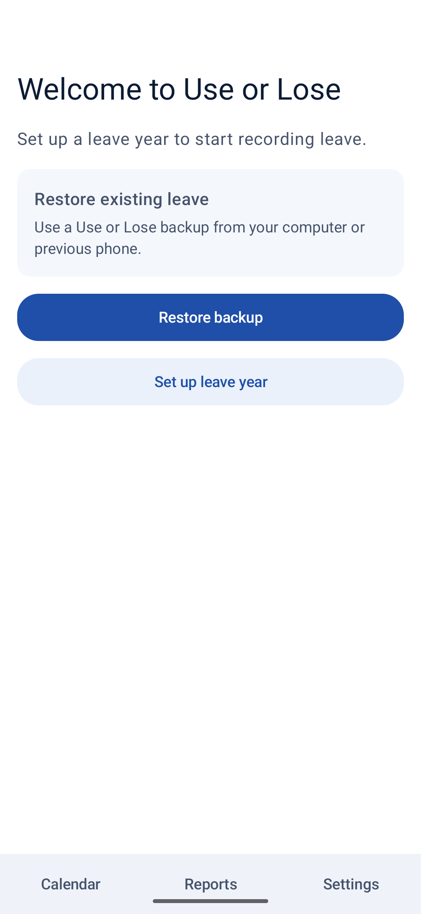
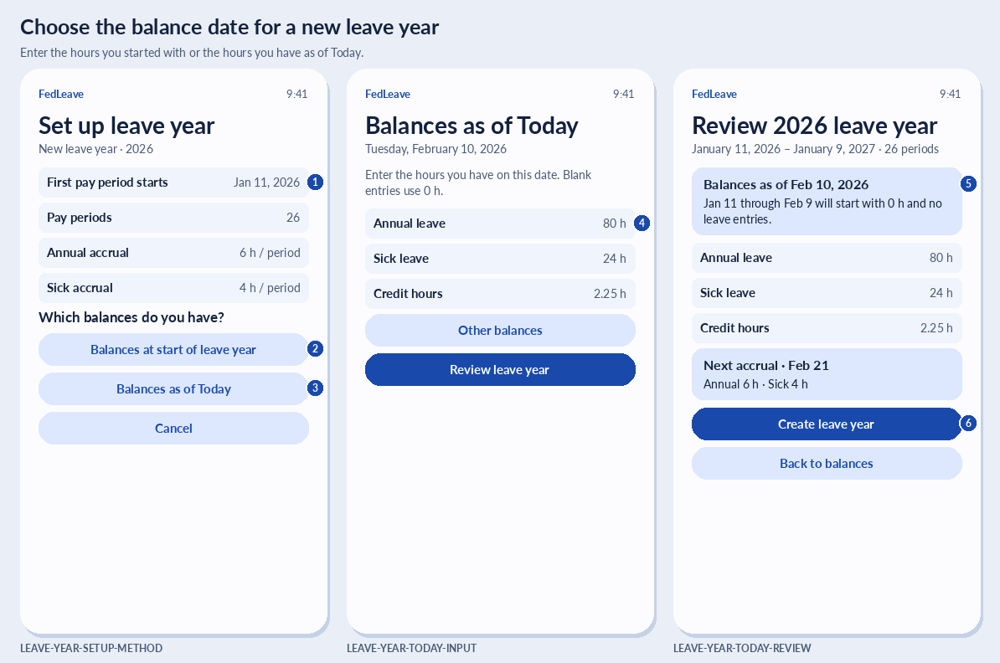
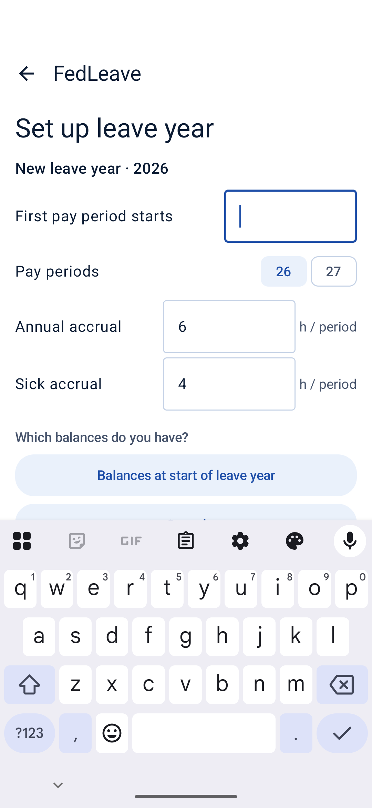
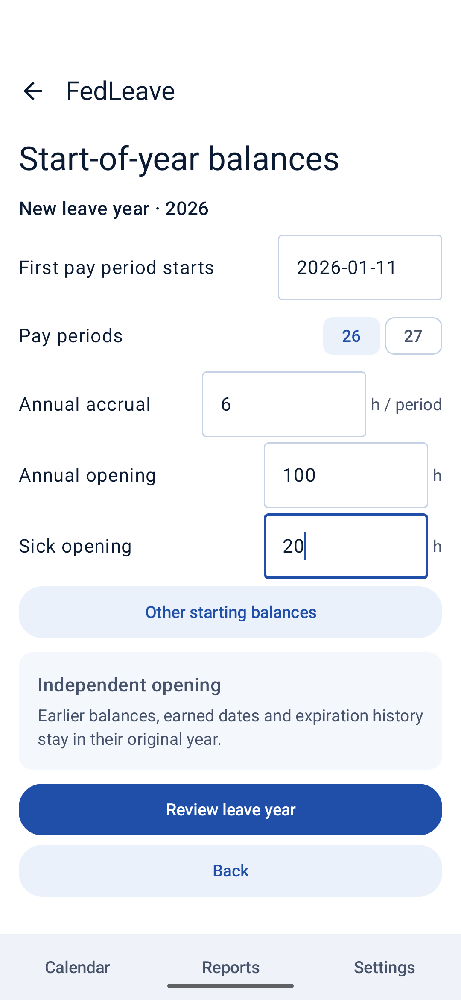
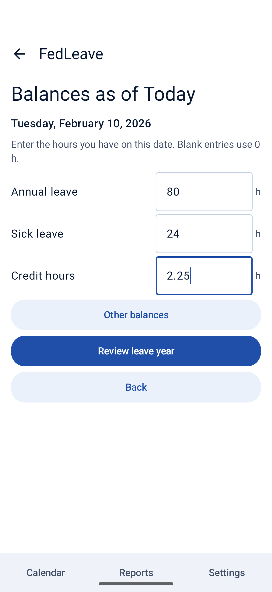
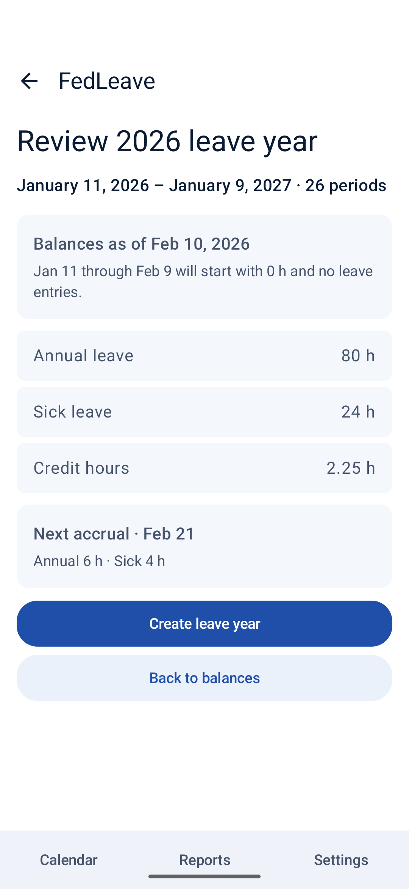

# QA report for milestone I06

## Candidate and scope

| Item | Evidence |
| --- | --- |
| Status | Pass |
| Spec revision and approved decisions | Specification v1.1; [I06 brief](../../implementation/briefs/I06-leave-year-setup.md) with P-D1…P-D6 approved by the owner |
| Code revision, build ID and source identity | `55f0b8f` + visual-loop `54d2ae5` + review fixes `a4c3be4`; fixture digests unchanged (`03e9e175…`, `d60bd8d0…`) |
| Implementation brief, starting revision, and preflight results | I06 brief; preflight: I04 store writer, I05 VM/routes/harness evidence passed |
| Package, check policy and isolation result, when delegated | Not delegated |
| Affected requirements, acceptance and screen IDs | `CAL-YEAR-01`, `YEAR-MAN-01`, `YEAR-TODAY-01`; cases `T-CAL-YEAR-01`, `T-YEAR-MAN-01`, `T-YEAR-TODAY-01`; screens LEAVE-YEAR-SETUP, LEAVE-YEAR-SETUP-METHOD, LEAVE-YEAR-MANUAL, LEAVE-YEAR-TODAY-INPUT, LEAVE-YEAR-TODAY-REVIEW |
| Device, API, density, font scale, theme and locale | Emulator `fedleave_test` (pixel_5), Android 16 (API 36), `x86_64`, 1080x2340 @ 440 dpi |
| Fixture revision, checksum and fixed clock | Calendar 2026 fixture for existing-store contexts; empty store for first use; frozen clocks 2026-01-16 and 2026-02-10 |
| Commands, CI run and evidence location | Commands below; no CI run (local only); captures under `qa/evidence/I05-02/` |
| Separate AI code review report | [I06 review](../../reviews/code/I06.md) |

## Checks on the final candidate

From `android/` with `JAVA_HOME=/usr/lib/jvm/java-21-openjdk-amd64` and the repository `.venv/bin` on `PATH`:

```bash
./gradlew :app:assembleDebug :app:testDebugUnitTest :app:lintDebug   # 47/47 unit tests
./gradlew :app:connectedDebugAndroidTest                              # 80/80 device tests
```

| Requirement and case | Expected | Observed | Status | Evidence |
| --- | --- | --- | --- | --- |
| First use (CAL-YEAR-01) | An empty store opens the welcome; Set up leave year is live; Restore backup shows its placeholder note | Verified end to end | Pass | `firstUseWelcomeCreatesAManualYearAndOpensTheCalendar`, `cancelOnTheMethodStepWritesNothingAndReturns` |
| Manual creation (YEAR-MAN-01) | Schedule fields, 26/27 periods, accrual rates, openings with units; the review shows the exact year metadata; one publish, merge with existing files, cancel writes nothing | The created 2027 ledger matches the desktop CLI reference (bounds, periods, auto rows); the existing 2026 files are carried forward byte-identically | Pass | `CreationBridgeTest.manualCreationMatchesTheDesktopReference`, `confirmMergesTheExistingStoreFiles`, `cancelAndPreviewWriteNothing`, `SetupViewModelTest` |
| Today balances (YEAR-TODAY-01) | Zero base rates, dated rate changes effective Today, forced-balance difference rows, zero pre-Today window, same-day accrual included once, next accrual preview | Host-side and on-device checks: Jan 24 zero; Feb 10 = targets; Feb 21 = 86/28/2.25; same-day accrual exact; year-end rates resolve; no zero-hour rows | Pass | `CreationBridgeTest.todayCreationMatchesTheAcceptanceArithmetic`, `todayChoiceCreatesTheYearWithTodayTargets`, host parity script results in the QA log |
| Uncovered date (CAL-YEAR-01) | The unavailable panel offers Set up leave year; the adjacent successor is proposed; creation resumes the balance lookup for the requested date | Verified with Jan 10, 2027 beyond the 2026 fixture; the card resumes on the created year | Pass | `uncoveredDateOffersSetupAndResumesTheLookup` |
| Staleness and duplicates | Preview captures the base generation; a competing change → StaleBase → re-review; a repeat confirm publishes nothing; a midnight rollover refreshes the preview | Verified on the JVM with the real writer, including the Today-kind rollover | Pass | `staleBaseForcesAReviewAndWritesNothing`, `duplicateConfirmationCannotPublishTwice`, `midnightRolloverRefreshesThePreview`, `todayMidnightRolloverRePreviewsAsToday` |
| Data safety | A recoverable store is never overwritten by setup; complete generations survive | Verified with a corrupt pointer | Pass | `recoverableStoreBlocksPublishAndPreservesTheGenerations` |
| Regression | I01–I05 suites unaffected | Unit 47/47; device 80/80; lint and assemble pass; the launch smoke test accepts either entry screen | Pass | Build logs |

## Visual comparison — the mockup loop

Three iterations of implement → capture → image-agent compare → fix code → recapture; all five setup screens now PASS.

| State | Annotated mockup | Final app capture | Result |
| --- | --- | --- | --- |
| LEAVE-YEAR-SETUP |  |  | **PASS** |
| LEAVE-YEAR-SETUP-METHOD |  |  | **PASS** |
| LEAVE-YEAR-MANUAL |  |  | **PASS** |
| LEAVE-YEAR-TODAY-INPUT |  |  | **PASS** |
| LEAVE-YEAR-TODAY-REVIEW |  |  | **PASS** |

Iteration 1 findings and fixes: the method row order differed; the accrual/opening fields lacked their unit suffixes; the Today form's date line was short; the Today review was missing the entered balance rows entirely (major); the next-accrual label carried the year; the back label was generic. Iteration 2 fixed those plus the keyboard-occluded captures. Iteration 3 added the start-form accrual suffix and the pill containers on the review rows; the final pass reported PASS on all five screens.

Known-expected differences (not defects): the app keeps its bottom bar and FedLeave header on every screen except the root welcome; editable fields with unit suffixes replace the mockup's static row values (ISO dates in fields); no annotation circles; the mockup's status-bar chrome is not app UI.

## Findings, fixes, and retests

| Finding and affected ID | First failing candidate and evidence | Fix | Retested candidate | Case and regression results | Status |
| --- | --- | --- | --- | --- | --- |
| F-1 · High — a Today-flow midnight rollover re-previews as a manual candidate and drops the targets | `55f0b8f`; independent review | Kind derived from the retained `previewKind` | `a4c3be4` | `todayMidnightRolloverRePreviewsAsToday` | Pass |
| F-2 · Medium — re-entering setup kept the published flag and exited immediately | `55f0b8f`; review | `begin()` resets the whole state | `a4c3be4` | `reEnteringSetupAfterPublishStartsClean` | Pass |
| F-3 · Medium — a recoverable store was overwritten by setup | `55f0b8f`; review | Recoverable stores show a data-review error; welcome routes only on Empty | `a4c3be4` | `recoverableStoreBlocksPublishAndPreservesTheGenerations` | Pass |
| F-4 · Low — the entered sick rate never reached the manual ledger | `55f0b8f`; review | The bridge passes the entered rate into the ledger build | `a4c3be4` | Host parity check (`sick_leave_accrual_hours` = input) | Pass |
| F-5 · Low — increment tolerance and finite guard differed from the desktop | `55f0b8f`; review | Desktop `EPSILON` (1e-6) + `math.isfinite` | `a4c3be4` | Full suites | Pass |
| Dev findings from the loop | See the three visual iterations above | All applied and re-verified by the image agent | `54d2ae5` | Full suite + final captures | Pass |

## Completion gates

| Gate | Status | Evidence or applicability reason |
| --- | --- | --- |
| Spec and traceability | Pass | Every I06 requirement and acceptance case links to the brief rows and this evidence; the pydantic-free bridge replication is recorded as the P-D1 implementation with the parity gate. |
| Build and functional behavior | Pass | Unit 47/47, device 80/80, assemble and lint pass on the final candidate; the created ledgers match the desktop CLI reference and the T-YEAR-TODAY-01 arithmetic read back through the real facade. |
| GUI conformance and accessibility | Pass | Three-iteration visual loop closed with the image agent on all five setup screens; unit suffixes, row order, review rows and labels verified. |
| Data and platform behavior | Pass | Preview/cancel write nothing; the publish carries the existing files forward; stale/recoverable/duplicate guards verified; store hashing around cancel and failure. |
| Code review and retest | Pass | [I06 review](../../reviews/code/I06.md) found one High and four lower findings; all fixed and regression-tested. |
| Completion and release evidence | Not applicable | No source push to `master`; Distribution rules apply on the first push. |

Completion decision: **I06 is complete** on commit `a4c3be4`. Next action: I07, carryover, from the [I06 passdown](../../implementation/passdowns/I06.md).
