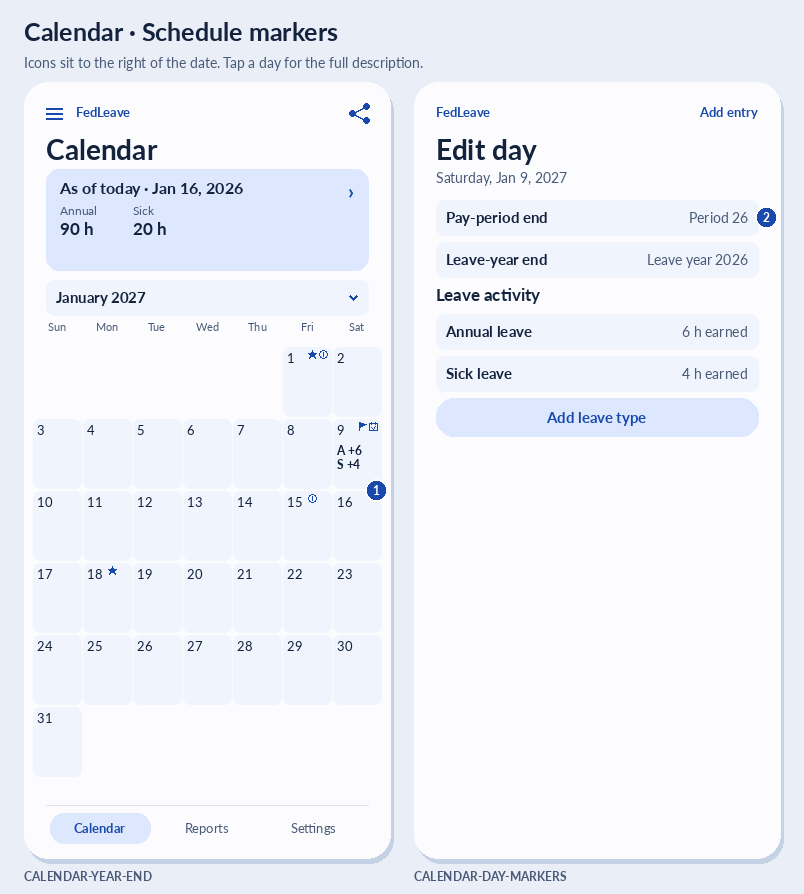

# Calendar date markers

Place schedule symbols immediately to the right of the day number in the month grid and the balance-date picker. The phone Calendar uses these symbols with full descriptions in the day editor and TalkBack. The desktop-equivalent printed PDF retains its own abbreviations and legend. [Calendar and picker](calendar-main-screen.md) · [Shared PDF](calendar-menu-and-pdf.md#share-the-displayed-month)

| Order | Symbol | Spoken and written description | Date source |
| --- | --- | --- | --- |
| 1 | Five-point star | Holiday, followed by the name | Read the compatible local holiday data for the displayed dates' calendar years. Match the holiday's display, observed, then actual date in that order. Show a holiday once per displayed date and speak each name if more than one applies. |
| 2 | Coin, drawn as a circle with a vertical stroke | Payday | For each validated period, add the display preference's payday offset in calendar days to its end date, as the desktop GUI does. Include matches from adjacent periods across month and leave-year boundaries. The January fixture uses a six-day offset. |
| 3 | Flag on a pole | Pay-period end, followed by the period number if known | Use the period's stored inclusive end date. Nearby closing-date shortcuts use the same schedule. |
| 4 | Check inside a calendar outline | Leave-year end, followed by the leave year | Match the exact local date to the validated ledger's inclusive `leave_year_end`. This often falls in January. |

Respect **Show Holidays**, **Show Paydays**, and **Show Pay Period Ends** in the visible markers and their equivalent accessible descriptions. The leave-year-end marker is always visible when a known year closes. Visibility settings affect rendering and descriptions. The same stored periods still supply closing-date shortcuts. Use only flags derived for the dates being shown. A missing holiday cache or schedule cannot create estimated markers. A missing schedule still follows the Calendar loading and recovery rules. [Desktop holiday lookup](../../../src/fedleave/commands/balances.py#L96) · [Desktop GUI display settings and payday rules](../../../src/fedleave_gui/main_window.py#L2439) · [Local holiday preferences](reports-data-and-preferences.md)

## Placement and overlapping markers

- Place up to two symbols per row, left to right in the table order, with a second row when needed. Keep the date number visible on the left and activity beneath that header. Use outlines and shapes that distinguish the four symbols in light, dark and selected states. The symbols carry no separate touch actions.
- Keep all applicable symbols. For example, January 9, 2027 has a flag and checked calendar at the same time. For four markers, show star and coin above flag and checked calendar. The symbol count stays independent of the **+N** for hidden leave activity.
- The cell or day row is the touch and focus target. On a width or font scale that cannot preserve legibility and 48 dp targets for the grid, use the full-width day list. In that list give each applicable event its text label. Use the same fallback within the balance picker, with rows selecting a cutoff date.
- Read the local date first in the accessibility label, then visible events in the table order, then leave activity if present. Example for the Calendar cell is **Saturday, January 9, 2027. Pay-period end, period 26. Leave-year end, leave year 2026. 6 hours annual leave earned. 4 hours sick leave earned.** The picker uses the date and events and exposes its selected state. The editor prints those event names before its leave activity. Tapping a Calendar date edits that date and leaves the balance cutoff alone.

| Callout | Interaction and states |
| --- | --- |
| 1 | At the leave-year boundary the grid contains two separate icons to the right of January 9. The main balance card still shows its own cutoff. |
| 2 | Open January 9 to read period 26 and the 2026 leave-year close above the existing activity. |

The January 2026 Calendar mockup shows a star for New Year's Day and Martin Luther King Jr. Day, a flag for January 24, and a coin for January 30. The January 2027 board uses the same leave year through January 9, plus illustrative holiday and schedule data for the displayed month. Rebuild with `python android/specficaiton/mockups/render.py android/specficaiton/mockups/calendar-markers.json`. [Acceptance test](../testPlan.md#calendar-acceptance-cases) · [Editable marker mockup](../mockups/calendar-markers.json)
