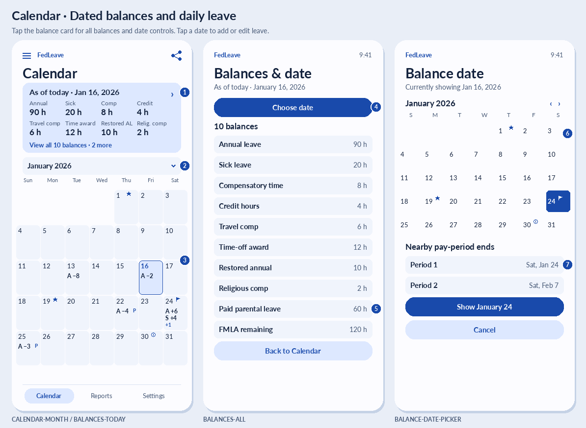
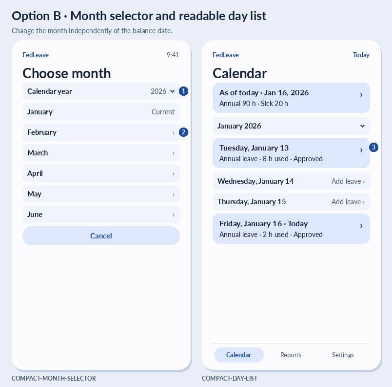
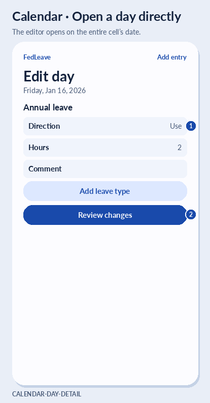

# Calendar main screen

The owner selected this layout with daily leave inside the month grid. Calendar opens with today's balances. Tap the balance card to open **Balances & date**. Tap the displayed month to choose another month, or tap a day cell to open that day's editor. **Menu** is at upper left and **Share calendar PDF** at upper right. [Menu and PDF mockups](calendar-menu-and-pdf.md)

| Callout | What happens |
| --- | --- |
| 1 | The whole card opens **Balances & date** at the same cutoff. The main screen shows two rows of four labeled amounts at the reference size. When two amounts are hidden, the card reads **View all 10 balances · 2 more**. TalkBack announces the date, visible balances, additional count, and action **Open balances and date**. |
| 2 | Tap the month and year to choose a month. Selecting a month changes the grid while preserving the balance cutoff. |
| 3 | Every day cell opens the editor for its date. A minus sign shows hours used, a plus sign shows hours earned, and **P** marks a planned entry. A day with no entries opens the same editor ready to add one. The day editor and TalkBack describe the symbols, leave categories, amounts, and status. [Date marker rules](calendar-date-markers.md) |
| 4–5 | The full view displays the cutoff and a **Choose date** control above the scrollable list. The list includes both values omitted by the card, with full labels and exact amounts. Back returns to Calendar at its prior month and shows the currently confirmed balance cutoff. |
| 6–7 | Choose an ordinary date or a nearby pay-period end, then confirm to update the full list and card to the same result. Back or Cancel returns to the full list with its previous cutoff and values. |

The balance example adds eight fictional values to the January 16 reference for layout review. The calculation and PDF fixtures keep their original amounts. The grid example enables automatic accrual display and adds one fictional future comp entry on January 24. The grid shows up to two activity lines and **+1** for the third. Tapping the day reveals all its activity. [Balance behavior and ordering](calendar-balances.md#preview-and-full-list) · [January calculation fixture](../testPlan.md#calendar-balance-fixture)

| Callout | What happens |
| --- | --- |
| 1–2 | Set the calendar year and choose a month. The list scrolls to all twelve months. A month change preserves the selected balance cutoff. |
| 3 | If seven readable 48 dp day targets cannot fit, display a full-width, scrollable list of dates for the month. Each row spells out day activity or offers to add leave. The balance card and month selector stay above it. |

| Callout | What happens |
| --- | --- |
| 1–2 | The editor opens on the whole cell's date with full labels and exact hours. **Review changes** opens the save review. Saving refreshes the displayed month and recalculates the balance at its existing cutoff. |

On shorter displays, scroll the Calendar content above the bottom navigation. Keep day text legible and avoid reducing the day targets to fit more on screen. [Visual QA gates](quality-gates.md#required-gates)

Rebuild with `python android/specficaiton/mockups/render.py android/specficaiton/mockups/calendar-compact.json`. [Editable Calendar source](../mockups/calendar-compact.json)
