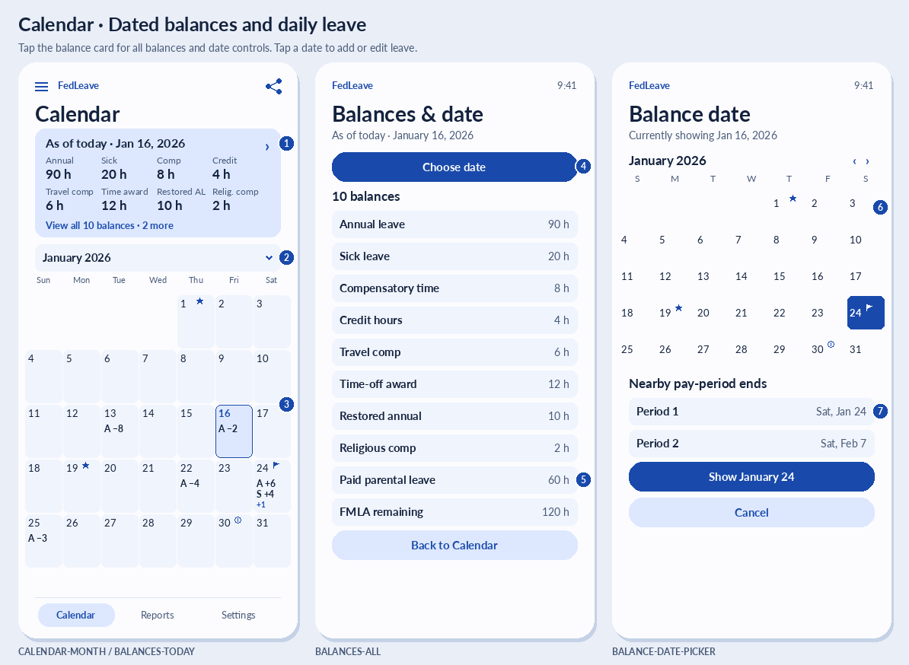
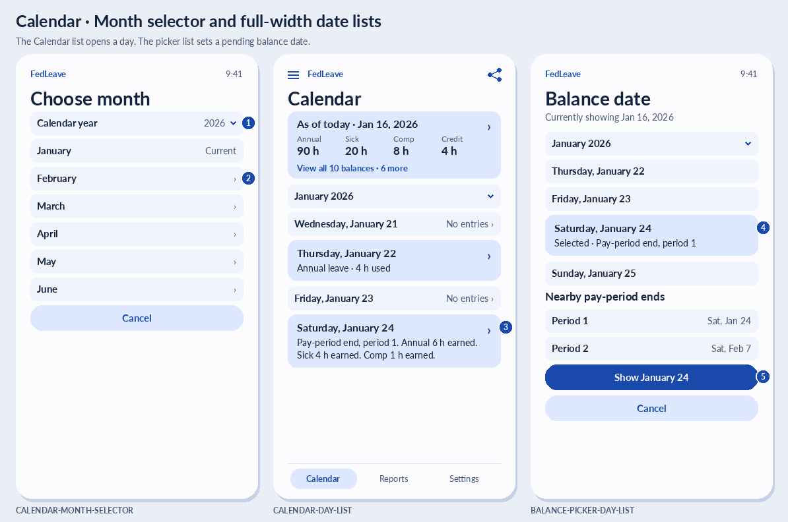
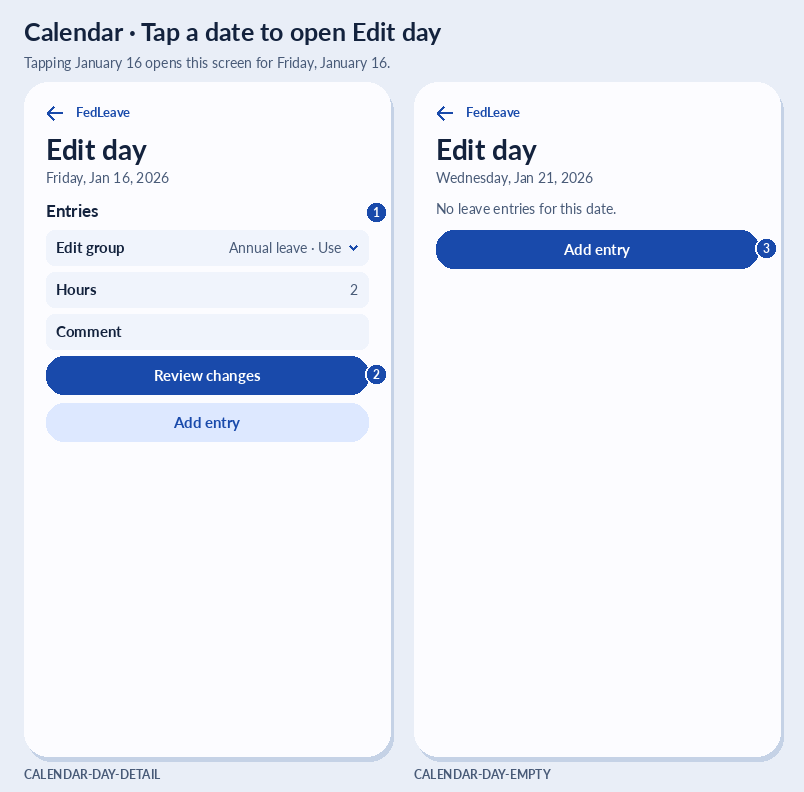

# Chapter 01.01 · Calendar main screen

The owner selected this layout with daily leave inside the month grid. Calendar opens with today's balances. Tap the balance card to open **Balances & date**. Tap the displayed month to choose another month, or tap a day cell to open **Edit day** for that date. **Menu** is at upper left and **Share calendar PDF** at upper right. **Reports** on the bottom bar opens all analytics. [Menu structure and tap paths](01-07-menu-structure.md)

| Callout | What happens |
| --- | --- |
| 1 | The whole card opens **Balances & date** at the same cutoff. The main screen shows two rows of four labeled amounts at the reference size. When two amounts are hidden, the card reads **View all 10 balances · 2 more**. TalkBack announces the date, visible balances, additional count, and action **Open balances and date**. |
| 2 | Tap the month and year to choose a month. Selecting a month changes the grid while preserving the balance cutoff. |
| 3 | Tap the January 16 day cell. It opens **Edit day**, with **Friday, Jan 16, 2026** under the title and the saved 2 h of annual leave shown below it. Tap an empty date to open the same screen on that date with **Add entry**. In the grid, a minus shows hours used and a plus shows hours earned on any date. TalkBack reads the date, applicable events, and the leave types and amounts. [See the exact screen that opens](#what-opens-when-you-tap-a-day) · [Date marker rules](01-04-date-markers.md) |
| 4–5 | The full view displays the cutoff and a **Choose date** control above the scrollable list. The list includes both values omitted by the card, with full labels and exact amounts. Back returns to Calendar at its prior month and shows the currently confirmed balance cutoff. |
| 6–7 | Choose an ordinary date or a nearby pay-period end, then confirm to update the full list and card to the same result. Back or Cancel returns to the full list with its previous cutoff and values. [Shortcut rules](01-02-balances.md#nearby-closing-date-shortcuts) |

The balance example adds eight fictional values to the January 16 reference for layout review. The calculation and PDF fixtures keep their original amounts. The grid example enables automatic accrual display and adds one fictional future comp entry on January 24. The grid shows up to two activity lines and **+1** for the third. Tapping the day reveals all its activity. [Balance behavior and ordering](01-02-balances.md#preview-and-full-list) · [January calculation fixture](../../verification/acceptance-tests.md#calendar-balance-fixture)

| Callout | What happens |
| --- | --- |
| 1–2 | Set the calendar year and choose a month. The list scrolls to all twelve months. A month change preserves the selected balance cutoff. |
| 3 | If seven readable 48 dp day targets cannot fit, display a full-width, scrollable list of dates for the month. Each row spells out schedule events and day activity. Tap any row to open **Edit day**, just as in the grid. The balance card and month selector stay above it. |
| 4–5 | On the same compact or large-text profile, the picker lists each date with its schedule descriptions. Selecting a row or shortcut changes the pending date. Confirm applies it. Cancel preserves the committed date. |

## What opens when you tap a day

| Callout | What happens |
| --- | --- |
| 1–2 | The tapped date appears below the **Edit day** title. Show its entries, full leave-type labels, exact hours, and any date events. Choose an entry group or tap **Add entry**. **Review changes** opens the save review. Saving refreshes the displayed month and recalculates the balance at its existing cutoff. |
| 3 | A day with no leave entries still opens **Edit day** on that date. **Add entry** opens the same entry form for any date. Back returns to the same Calendar month with its existing balance date and focus on the tapped date. |

I05 first wires the date route for inspection. I08 adds the controls in these release mockups. An eligible date without a ledger can open leave-year setup, then return to **Edit day** on the original date. [Editing and save review](01-03-navigation-and-screens.md#add-and-review-leave) · [Missing-year behavior](../02-ledger/02-01-ledger-and-leave-years.md#start-or-find-a-leave-year)

On shorter displays, scroll the Calendar content above the bottom navigation. Keep day text legible and avoid reducing the day targets to fit more on screen. [Visual QA gates](../05-quality/05-02-quality-gates.md#required-gates)

Rebuild with `python android/specification/artwork/mockups/render.py android/specification/artwork/mockups/calendar-compact.json`. [Editable Calendar source](../../artwork/mockups/calendar-compact.json)
