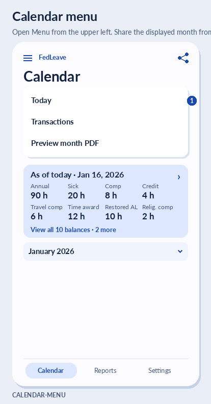
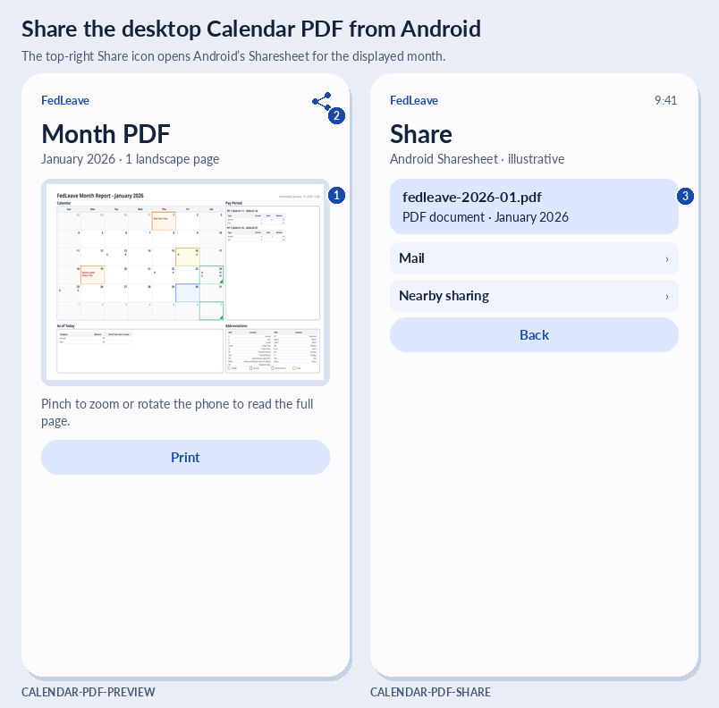

# Chapter 01.05 · Calendar menu and PDF sharing

Calendar uses the **Menu** icon at the upper left and the **Share calendar PDF** icon at the upper right. The balances card shows the balance date, and the calendar shows the month. Use the upper-right Share placement on report screens that have a shareable result. Give both icons 48 dp touch targets and spoken labels. [Calendar main screen](01-01-main-screen.md) · [Reports sharing](../03-reports-data/03-02-report-screens.md#month-preview-share-and-print)

## Open the Calendar menu

| Callout | Interaction | Requirements |
| --- | --- | --- |
| 1 | The Menu icon opens three commands. **Today** resets the calendar month and balance date. **Transactions** opens history. **Preview month PDF** opens the displayed month's PDF for inspection or printing. | `CAL-MENU-01`, `CAL-BAL-05`, `CAL-HISTORY-01` |

The grid uses the available space below the balances and month controls. Open a day to read the schedule events and leave entries. [Date markers](01-04-date-markers.md)

## Share the displayed month

| Callout | Interaction | Requirements |
| --- | --- | --- |
| 1 | **Menu > Preview month PDF** opens the landscape page. The preview supports zoom and rotation. **Print** hands the same page to the platform print service. | `REP-MONTH-01`, `CAL-MENU-01` |
| 2 | Tap the upper-right Share icon on Calendar or its PDF preview. Prepare the PDF for the displayed month and open Android's Sharesheet directly. | `CAL-SHARE-01` |
| 3 | Android shows `fedleave-YYYY-MM.pdf` to share. The user chooses the receiving app. Back returns to the screen that launched Share with its month and balance date intact. | `CAL-SHARE-01` |

Use the desktop **Save Month as PDF** report as the reference for the layout and values. Preserve the landscape page, month grid, leave activity and date markers, pay-period tables, **As of Today** balances, applicable year-end figures, and the complete printed abbreviations. The PDF keeps the desktop report legend. Report balances follow the desktop report's Today cutoff even when the main balance card is set to a different date. Compare rendered PDFs at a matched page size and with the same fixture and report clock. [Desktop PDF generation](../../../../src/fedleave_gui/main_window.py#L2234) · [Report renderer](../../../../src/fedleave_month_report_graphic/report.py#L440)

The image in the mockup is a page rendered from the desktop app's **Save Month as PDF** path using the January 2026 Calendar fixture with Today fixed to January 16. The inspected sample is one landscape A4 page. Tap the reference for the full-size view. [Full-size desktop PDF reference](../../artwork/mockups/calendar-desktop-pdf-reference.png) · [January fixture](../../verification/acceptance-tests.md#calendar-balance-fixture)

On Share, use a read-only snapshot of the requested month. A temporary PDF with MIME type `application/pdf` goes to Android's Sharesheet using the existing artifact lifecycle. Show progress during preparation and offer Retry after failure. Share from a Reports detail may offer PNG or PDF if both are supported. [Artifact sharing](../04-architecture/04-02-device-storage.md#artifact-sharing-and-lifecycle)

Rebuild the menu and share mockups with `python android/specification/artwork/mockups/render.py android/specification/artwork/mockups/calendar-actions.json`. The renderer uses the full-size desktop reference image above.
