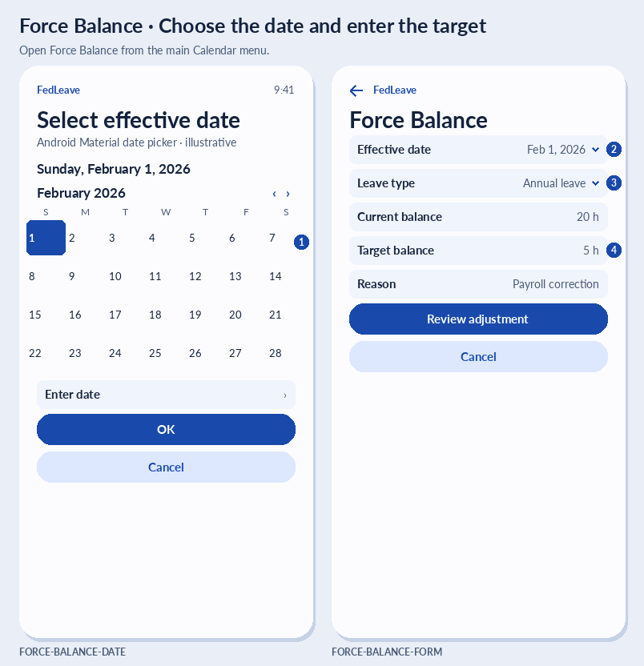
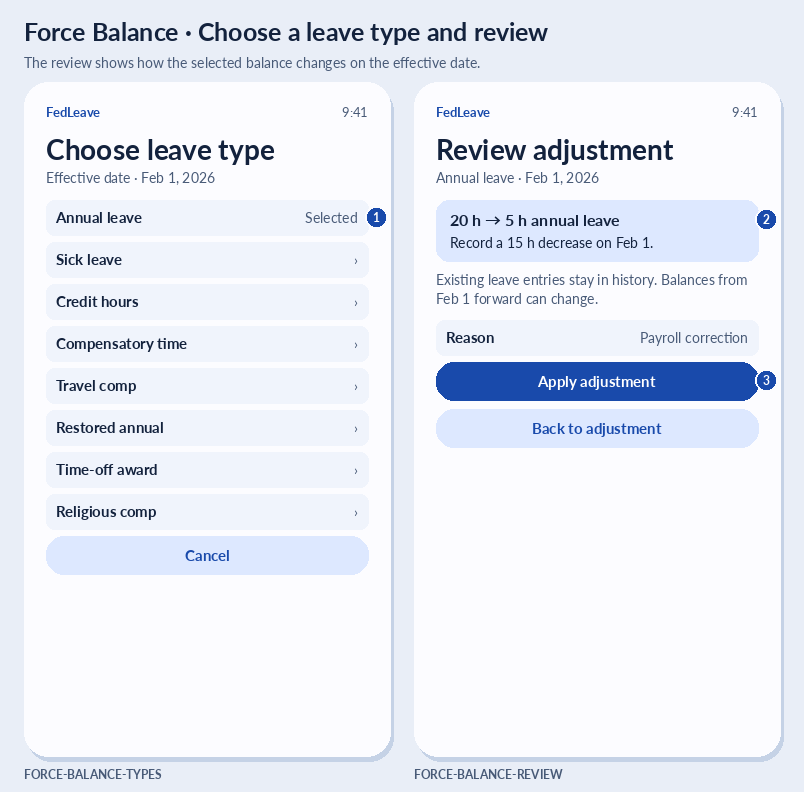

# Chapter 01.06 · Force Balance

Use **Calendar → Menu → Force Balance** when you know the correct balance for one leave type on a date. The adjustment brings that date to the entered target while keeping the original clocking entries. **Settings → Accounting and leave years → Leave-year maintenance → Force Balance** opens the same form. [Calendar menu](01-05-menu-and-pdf.md#open-the-calendar-menu) · [Desktop command](../../../../src/fedleave/commands/forced_balance.py)

| Callout | Interaction |
| --- | --- |
| 1–2 | Start with the normal Android Material date picker. Default the pending date to Today when it belongs to a valid ledger. Allow calendar browsing and standard date entry. Confirm with **OK**. Cancel leaves the previous date or returns to Calendar on first entry. Tapping **Effective date** in the form reopens the picker. |
| 3–4 | Choose a balance-tracked leave type after selecting the date. Show the current balance as of that date. Enter the exact target in hours and give a reason. Keep the target blank until the user enters it. An explicit zero is valid. **Review adjustment** uses the selected date and type. |

| Callout | Interaction |
| --- | --- |
| 1 | Selecting a leave type returns to the form and loads its dated balance. Cancel retains the prior choice. |
| 2–3 | Show the selected year and date, current and target values, the increase or decrease to record and the reason. Explain that later balances can change. **Back to adjustment** retains the draft. **Apply adjustment** confirms the review once. |

## Validate and publish the adjustment

- Use the standard Material 3 modal date picker and convert its selected day to `LocalDate` before looking up the inclusive leave-year range. A date outside a valid existing year leaves the form open with an explanation. PPL, FMLA, and usage-only types are handled through their own records. Accept a finite, nonnegative target in the configured hour increment and a nonblank reason. Keep quotes and punctuation as ledger text. [Android date picker](https://developer.android.com/develop/ui/compose/components/datepickers)
- `CAL-FORCE-01` uses a canonical read-only snapshot as of the effective date with all due accruals calculated in memory. Preview the current displayed balance, the target, and the signed difference that the app would store. On repeat, remove only the existing effective `forced-balance` row for that leave year, date and category from the candidate and calculate the new difference from the resulting unadjusted balance. Show the new stored difference and any replaced row if the check differs from the visible current-to-target change.
- For a nonzero difference write one reconciled transaction with `source: forced-balance`, `direction: forced_increase` or `forced_decrease`, the absolute hour difference, the selected date, and the reason. When the target matches the unadjusted balance, remove the prior adjustment if it exists and create no new row. Preserve unrelated rows, IDs and comments. Show any expiration provenance or affected linked-year warning, and use the existing carryover review for downstream updates.
- Preview and Cancel make no writes. Revalidate the reviewed store and target under the single writer before applying. A changed store requires a refreshed preview and confirmation. Verify the resulting dated balance before publishing a complete validated candidate. On failure keep the draft and ledger. On success show the confirmed date, leave type and balance, refresh the result and return to the initiating screen with its month and selected balance cutoff preserved. [Storage and recovery](../04-architecture/04-02-device-storage.md#write-and-recovery-model) · [Acceptance case](../../verification/acceptance-tests.md#ledger-and-leave-year-acceptance)

The date picker mockup illustrates standard controls. Follow the native Android layout for the device and locale. Rebuild the two boards with `python android/specification/artwork/mockups/render.py android/specification/artwork/mockups/calendar-force-balance.json`.
