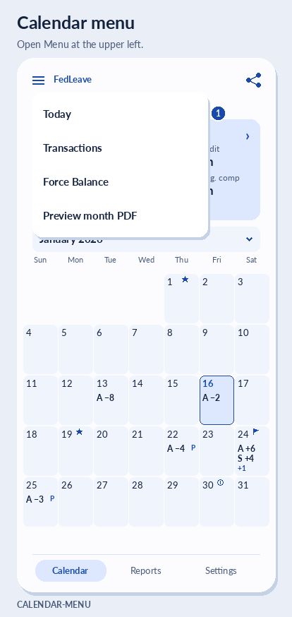
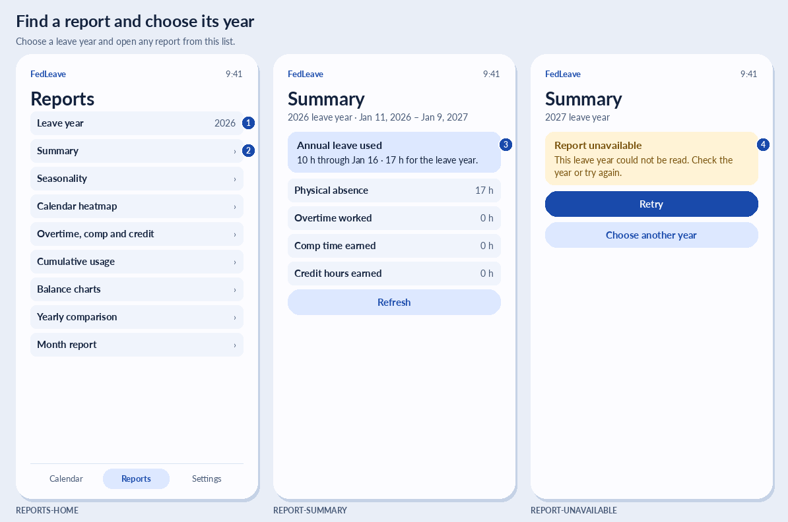
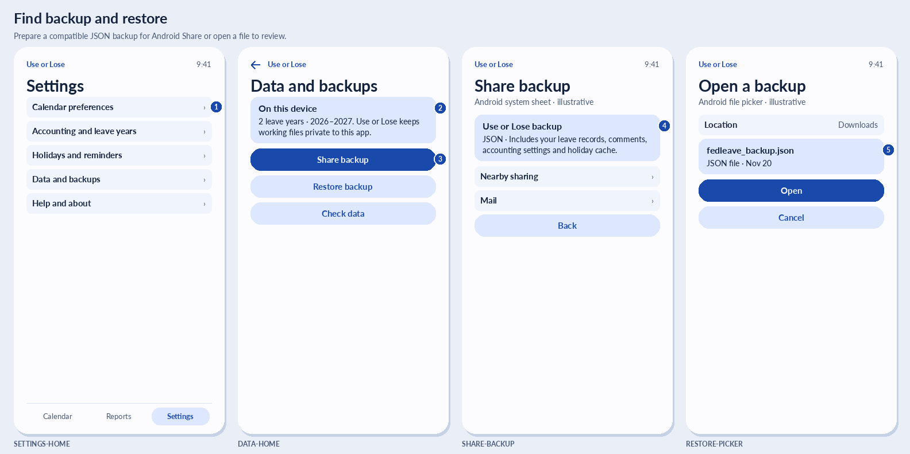
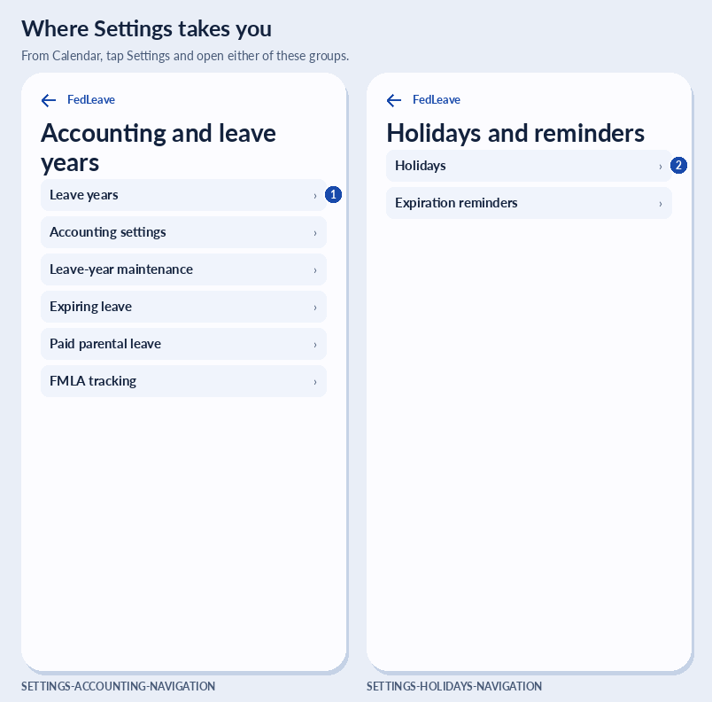

# Chapter 01.07 · Menu structure and tap paths

Use these screens for the owner's navigation review. The Reports entry point and direct Calendar Share are decided. The owner approved these labels, routes, and Back behavior on November 23, 2026; see [checkpoint 29](../../passdowns/29-menu-review-approval.md).

Open Use or Lose on **Calendar**. The bottom bar reads **Calendar · Reports · Settings** in that order. **Reports is where you go for all analytics.** Tap **Reports** at the bottom and choose the chart or report you want. Tap **Settings** at the bottom for preferences, leave-year maintenance, backups, and Help. The upper-left **Menu** is a short list of Calendar commands. The upper-right **Share calendar PDF** button acts on the month shown in Calendar.

| From the Calendar main screen | What opens |
| --- | --- |
| Upper-left **Menu** | A dropdown over the calendar with **Today**, **Transactions**, and **Force Balance**, in that order. |
| Bottom **Reports** | The report list, with a **Leave year** selector first. |
| Bottom **Settings** | Five labeled sections, with **Help and about** as the last row. |
| Upper-right **Share calendar PDF** | Android’s Sharesheet with the PDF for the month on screen, after the PDF is generated. |
| Any day cell or date row | **Edit day** for that exact date, with its entries and day events. |

[Calendar layout and Edit day](01-01-main-screen.md) · [Calendar Share behavior](01-05-menu-and-pdf.md#share-the-displayed-month)

## Calendar dropdown

| Tap path | Result |
| --- | --- |
| **Calendar → Menu → Today** | Go to the current month and day and set the balance card to today. |
| **Calendar → Menu → Transactions** | Open the transaction list. Start with the browsed month as the inclusive date range and let the user change or sort it. Choose a row for its details and available corrections. |
| **Calendar → Menu → Force Balance** | Open the effective date picker, then select the leave type and enter the hours. The adjustment has its own review and confirmation. |

Tapping outside or pressing Back while the dropdown is open dismisses it and restores focus to Menu. Back from Transactions or a cancelled Force Balance returns to the prior displayed month and balance date. **View transactions** inside a pay-period detail opens the same list with that period's dates. [History screens](01-03-navigation-and-screens.md#history-and-corrections) · [Force Balance screens](01-06-force-balance.md)

## Reports and analytics

Tap **Reports** from the Calendar bottom bar. **Leave year** selects a stored leave year and shows its actual dates. Tap any row below it to open that view in the selected leave year. The eight rows appear in the following order.

| Tap after **Calendar → Reports** | What opens and where to go next |
| --- | --- |
| **Summary** | Overview of absence, overtime, comp, and credit. Open the relevant warning when a value depends on incomplete data. |
| **Seasonality** | Usage or activity grouped by month, weekday, or pay period. Choose **Analysis** and **Leave type**, then tap the chart to expand or open exact values and contributing entries. |
| **Calendar heatmap** | The whole leave year. Choose the metric, switch to a focused **Month**, or expand the chart to inspect dates and open their entries. |
| **Overtime, comp and credit** | A **View** selector for **Summary**, **Comp lots**, **Allocation details**, **Expiration performance**, **Monthly overtime, comp and credit**, **Monthly comp**, and **Monthly credit**. Select a row for its source or lot detail where available. |
| **Cumulative usage** | Running hours used. Choose absence categories and open the daily values or tap the chart to expand. |
| **Balance charts** | Pay-period ending balances. Choose **Annual leave**, **Sick leave**, **Credit hours**, **Comp time**, **Travel comp**, or **Time-off awards**. |
| **Yearly comparison** | Compare the same date across leave years. Choose a month/day and one of the six balance categories above or overtime. View the exact dated results. |
| **Month report** | Choose a month and view its pay-period results on-screen. **Share** offers the desktop-style PDF or a PNG of that month. |

For a plotted report, tap its chart to open the full-screen view. Back returns to the report with its selection and scroll position. Back from the report returns to the Reports list with its selected year. The Calendar tab returns to the existing month and balance cutoff. [Report screens](../03-reports-data/03-02-report-screens.md) · [Full-screen chart controls](../03-reports-data/03-02-report-screens.md#full-screen-charts)

## Settings and Help

| Tap after **Calendar → Settings** | What opens |
| --- | --- |
| **Calendar preferences** | Week start, displayed payday offset, automatic accrual visibility, and Calendar marker switches in one form. |
| **Accounting and leave years** | **Leave years**, **Accounting settings**, **Leave-year maintenance**, **Expiring leave**, **Paid parental leave**, and **FMLA tracking**. |
| **Holidays and reminders** | **Holidays** for the local holiday list and offline regeneration, and **Expiration reminders** for reminder thresholds. |
| **Data and backups** | **Share backup**, **Restore backup**, and **Check data**. Check data links to carryover review and specific recovery or repair when applicable. |
| **Help and about** | Opens the offline **Help** index. Choose **Set up a leave year**, **Record or correct leave**, **Share or restore a backup**, **Leave abbreviations**, **Calendar date markers**, or **About Use or Lose**. |

**Leave years** opens the year chooser and setup. Choosing an existing year explicitly goes to Calendar in that year and keeps the balance cutoff. **Accounting settings** opens the work tour, increment, accrual defaults and rules. **Leave-year maintenance** has **Correct starting balance**, **Force Balance**, **Change accrual**, and **Annual use or lose**. **Expiring leave** links to lot details and approved extensions.

To look up a date symbol, tap **Calendar → Settings → Help and about → Calendar date markers**. The Help article shows each symbol beside its meaning. Back returns to Help, then to Settings. **About Use or Lose** shows the version and project website. [Settings screen details](../03-reports-data/03-03-data-and-settings-screens.md) · [Date markers Help mockup](../../artwork/mockups/settings-calendar-markers-help.png)

## Navigation behavior for review

- Keep the bottom bar on the three main screens. Detail screens show Back and preserve their opener. Back closes a dropdown or picker first, then returns one level. At Reports or Settings home, Back returns to Calendar. At Calendar home, Back uses Android’s normal root behavior.
- Preserve Calendar month, confirmed balance date and scroll position when visiting Reports or Settings. Keep the Reports leave year and list position when returning to its home. Restore report filters, selected values, and scroll on Back from charts or supporting entries. Tapping a bottom tab opens its home.
- Show only working destinations in interim builds. In release QA, start on Calendar and verify all dropdown commands, all eight Reports rows, and all five Settings rows. Include the Help path, focus return, large text without clipping, state retention, and exact visible and spoken labels. [Navigation acceptance](../../verification/acceptance-tests.md#calendar-acceptance-cases)
