# Chapter 03.02 · Report screens and sharing

Reports is a phone destination with a year selector and report list. Keep interactive chart controls beside the result they affect. Use the upper-right Share icon when the report has a shareable result. Open long tables and supporting entries as details. Read aloud the chart title, units, timeframe and selected value. Pair colors with labels or visual marks. System picker and Sharesheet UIs vary by phone.

[Report requirements](03-01-reports-data-and-preferences.md#reports) · [Acceptance cases](../../verification/acceptance-tests.md#reports-acceptance)

## Reports list and summary

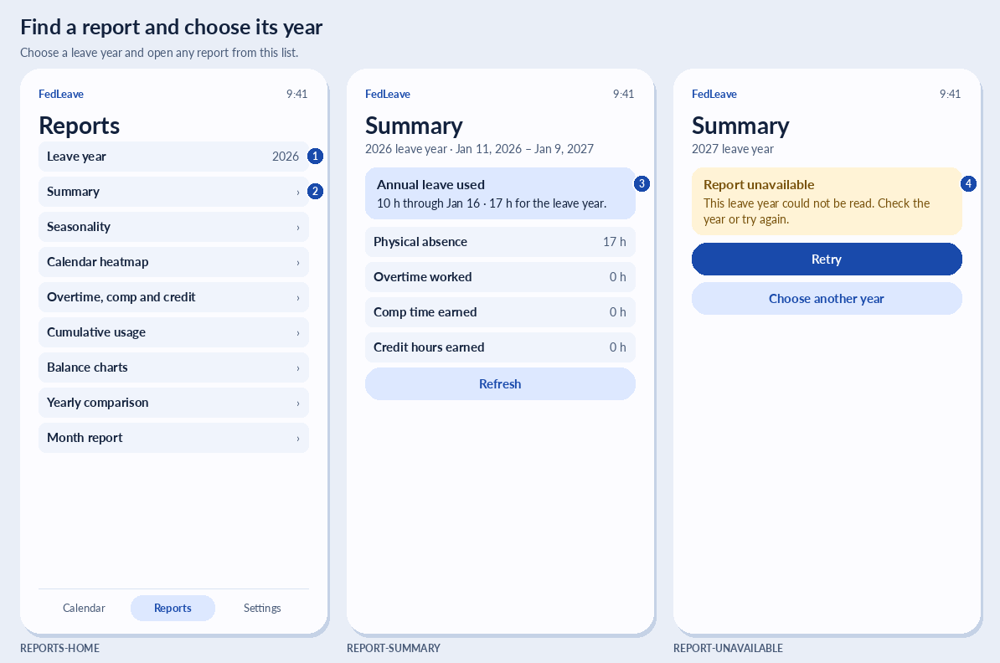

| Callout | Interaction and states | Requirements |
| --- | --- | --- |
| 1–2 | Choose a valid leave year, see its date range in each report, and open a report without changing Calendar's balance date. The phone list is scrollable at large text size. | `REP-SUM-01`, `PREF-YEAR-01` |
| 3–4 | Show recorded, scheduled, and full-year results where applicable. Link data-quality warnings to details. Refresh uses current local data. Show unreadability or incomplete history without inventing a numeric zero. | `REP-SUM-01` |

## Activity breakdowns and supporting entries

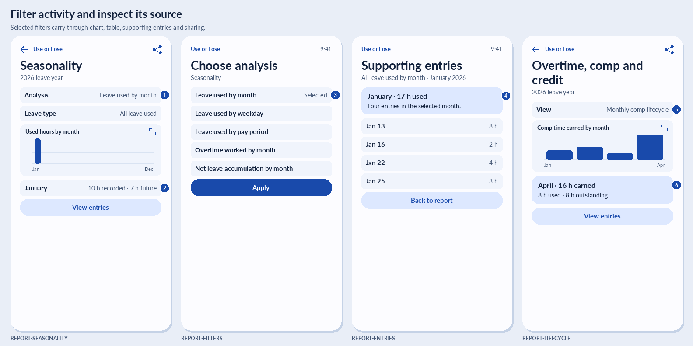

| Callout | Interaction and states | Requirements |
| --- | --- | --- |
| 1–3 | Analysis and Leave type drive the chart, exact table, and shared result. Filter sheets list supported category and activity choices. Disabled Leave type remains visible for overtime and net accumulation. Chart and row values identify recorded and scheduled amounts. | `REP-SEA-01`, `REP-SHARE-01` |
| 4 | Open **View entries** with date, source, status and hours matching the selected report row or cell. Back retains the original report filters and scroll position. | `REP-SEA-01`, `REP-HEAT-01`, `REP-LIFE-01`, `REP-CUM-01` |
| 5–6 | Use this selector layout for the seven lifecycle views. Keep tables handy for the summary, lots, allocation and expiration performance. Empty or incomplete queries keep the view label and either explain the empty set or show unavailable values. | `REP-LIFE-01` |

## Heatmap, usage, and balance charts

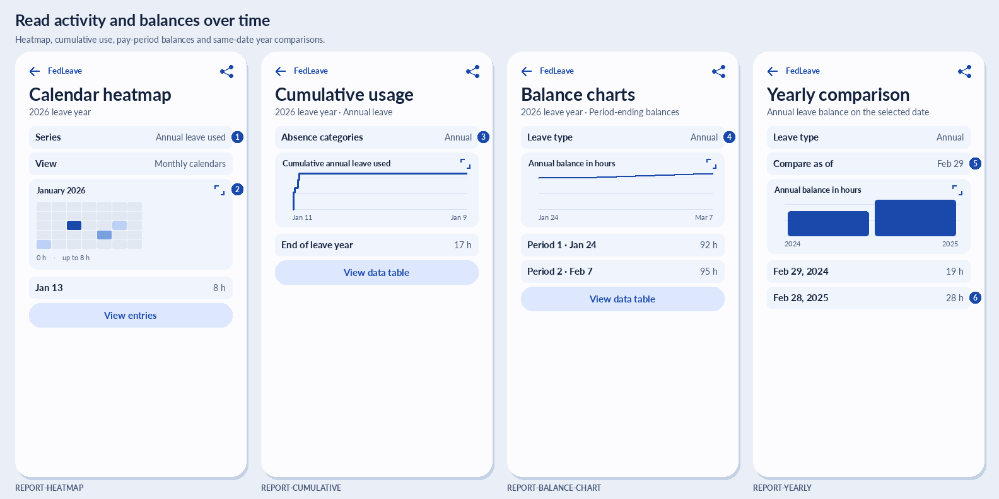

| Callout | Interaction and states | Requirements |
| --- | --- | --- |
| 1–2 | Heatmap offers a full leave-year view and a focused month view. Tap the chart to expand it, then select a cell to read its exact date and value. Keep the exact rows accessible from the report. | `REP-HEAT-01` |
| 3 | List or select multiple absence categories. View exact cumulative daily entries. Preserve the whole-year extent and show the time context. | `REP-CUM-01` |
| 4 | Choose from the six balance series. A period point label includes its end date and balance. The exact table is navigable independently of the chart. | `REP-CHART-01` |
| 5–6 | Keep the selected month and day visible and list the date actually mapped into each comparison year. Provide the seven supported category choices. | `REP-YOY-01` |

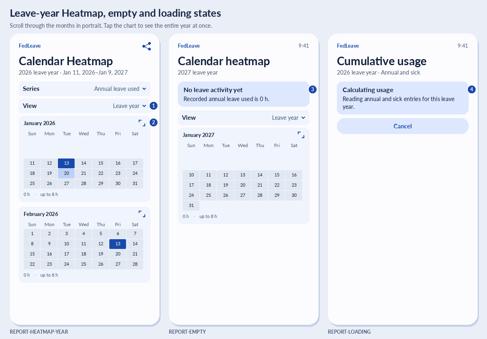

| Callout | Interaction and states | Requirements |
| --- | --- | --- |
| 1–2 | The portrait leave-year view scrolls through month grids. The example shows January and February. Tap a month grid to open the full-year landscape layout. | `REP-HEAT-01` |
| 3–4 | A validated year with zero activity still shows its dates. A read problem uses the unavailable state. Cancel a pending calculation without clearing the selected categories. Older results cannot overwrite the current selection. | `REP-SUM-01`, `REP-HEAT-01`, `REP-CUM-01` |

### Entire leave year in the Heatmap

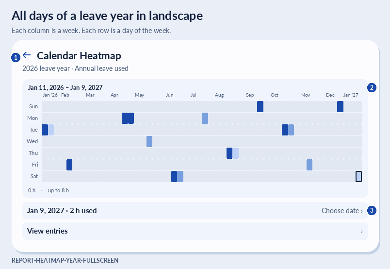

| Callout | Interaction |
| --- | --- |
| 1 | Back returns to the original report or portrait Heatmap. Preserve the selected year, series, date and scroll position. |
| 2 | Show one cell for each day in the selected leave year, including the first and last days. Columns are weeks and rows are weekdays, respecting the user's first-weekday setting. The full-width grid shows all weeks at once on a supported landscape phone. Label month boundaries, including the year where January appears twice. |
| 3 | Tapping a cell shows its exact calendar date and hours. **Choose date** provides a standard Android date picker with a 48 dp target for precise selection. **View entries** opens matching source rows. |

**Leave year** is the default. In a usable portrait window, stack all month grids chronologically and scroll them vertically. Include partial months at both ends. **Month** remains available for inspecting a single month. Tap any month grid while Leave year is active to open the landscape overview of the whole year and retain the current series and date context.

On a portrait window that cannot fit seven day columns at 36 dp each, or when text scaling causes labels to clip, open the full-screen landscape year directly. Back from that direct entry returns to the originating report destination. When Android does not grant landscape, use the full available window with scrollable month grids or a full-width date list for a narrower window. Each date and exact value remains reachable. The portrait month grids are whole-chart buttons. The exact date picker and values view provide full-sized accessible controls for selecting individual dates from the overview.

Generate date cells from the stored inclusive start and end dates, including the part of a leave year that falls in the next calendar year. Compute the number of columns from the actual bounds and first weekday. Leave padding before the first and after the last date blank. For a valid zero-activity year, show a zero-valued year grid using annual leave used as the default series. Keep missing or unreadable content in the existing unavailable state.

Rebuild the landscape year board with `python android/specification/artwork/mockups/render.py android/specification/artwork/mockups/reports-heatmap-year.json`.

## Full-screen charts

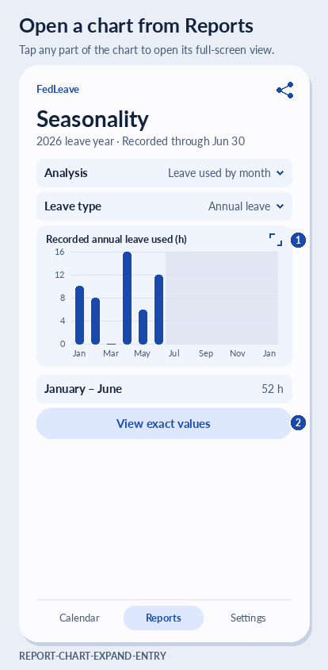

| Callout | Interaction and states | Requirements |
| --- | --- | --- |
| 1–2 | Tap anywhere on the chart or its expand icon. The whole chart is one control and TalkBack names it **Expand chart**, followed by the chart title. **View exact values** opens the report data from the portrait screen. | `REP-EXPAND-01` |

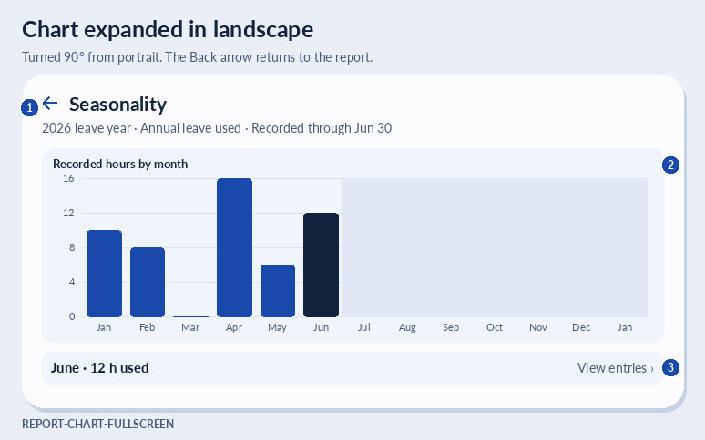

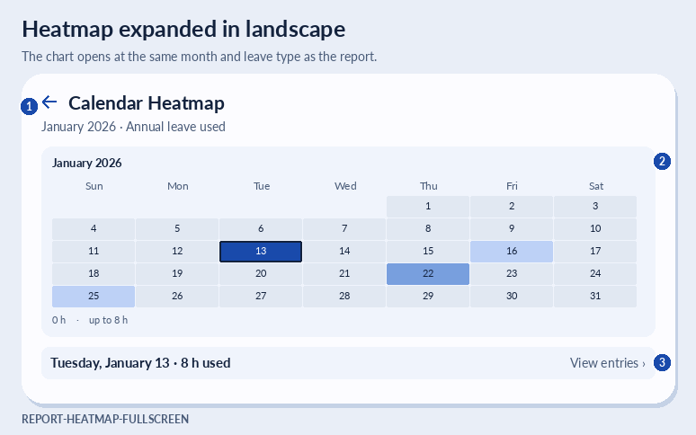

| Callout | Interaction and states | Requirements |
| --- | --- | --- |
| 1 | The upper-left **Back** arrow returns to the initiating report. System Back follows the same path. Restore its previous orientation policy, scroll position and focus on the chart. | `REP-EXPAND-01` |
| 2 | Redraw the chart across the landscape app window below the title. Keep the timeframe, units, labels, selected series and filters. The expanded chart replaces bottom navigation while open. | `REP-EXPAND-01` |
| 3 | Select a bar, point, or heatmap cell in the expanded chart to read its exact value. **View entries** opens matching source rows where the report supports them. Back from the rows returns to the chart and its selected point. | `REP-EXPAND-01`, `REP-HEAT-01`, `REP-SEA-01` |

Use the same expansion action for Seasonality, focused-month and leave-year Heatmaps, lifecycle plots, Cumulative Usage, balance charts and yearly comparison. A successful plotted result enables the action. Loading or unavailable states keep their existing message and recovery. Reuse the current result identity and selection in the expanded route. Rotation, Back and window resizing must keep the view's state and must not reset filters or issue duplicate computations. The chart is read-only.

The expanded route receives the initiating report's result key, selected chart and point key, and the return scroll anchor. Keep the result in the report state holder across configuration changes. The expanded route requests landscape by applying `SCREEN_ORIENTATION_SENSOR_LANDSCAPE` while it owns the chart screen. Save the prior requested orientation, then restore it when leaving for the report. Source entries opened from the chart keep the chart route and selection on the back stack.

On a supported full-screen phone, request landscape for the lifetime of the expanded route, so a portrait report turns 90° when opened. Fill the available app window on either landscape side and keep Android system Back and safe insets accessible. On a device or window that ignores the request, lay out the same full-screen view in the available orientation. Preserve the Back arrow, chart and exact values in that fallback. [Android orientation request](https://developer.android.com/reference/android/app/Activity#setRequestedOrientation(int)) · [Android adaptive layouts](https://developer.android.com/about/versions/16/behavior-changes-16#adaptive-layouts)

Rebuild the expanded chart boards with `python android/specification/artwork/mockups/render.py android/specification/artwork/mockups/reports-expanded.json`.

## Analytics with one, six, or eleven months

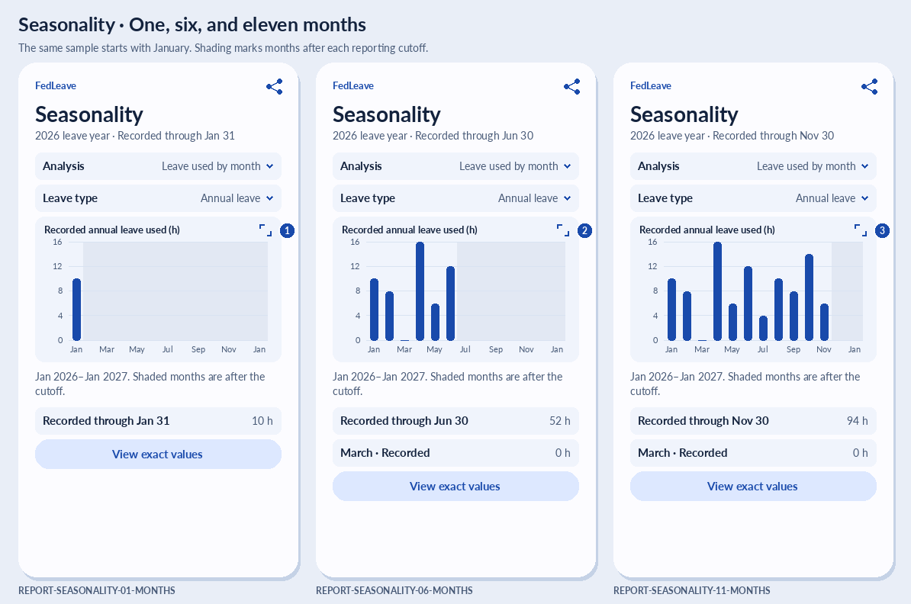

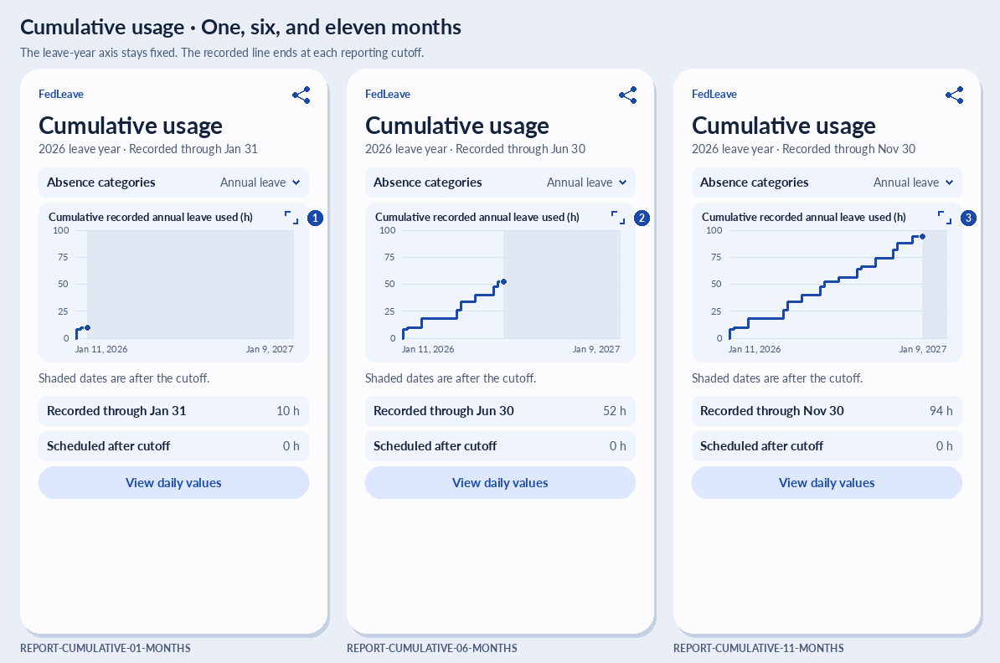

| Callout on each board | Reporting cutoff | Expected recorded annual leave used |
| --- | --- | ---: |
| 1 | January 31, 2026 | 10 h |
| 2 | June 30, 2026 | 52 h |
| 3 | November 30, 2026 | 94 h |

Use the same synthetic leave year, selected category and chart scales in the three examples. The first and last month labels are January 2026 and January 2027. Show the year on accessible month labels and on exact values. Each example is a separate case with a different local reporting date. The app still uses its existing leave-year and category selectors. [Synthetic transactions and acceptance](../../verification/acceptance-tests.md#analytics-history-fixture)

- **Seasonality.** Keep the calendar-month positions of the selected leave year. Show an actual recorded zero where an elapsed month has no matching usage, as in March. Shade months after the cutoff and leave their recorded bars empty. Identify the shaded area in visible and spoken text. Include any effective future scheduled values with their distinct series and status.
- **Cumulative Usage.** Keep the horizontal axis on the stored leave-year bounds. Stop the recorded line at the actual cutoff and label its last value. In these fixtures there is no future activity. When future scheduled entries exist, distinguish their cumulative portion and its exact data from the recorded line. Preserve the source report's full-year calculation and values.
- Use the same cutoff, values, units, and recorded/scheduled distinction in the portrait and expanded charts, the exact table, and the relevant shared artifact. An unavailable dataset uses the existing report warning or unavailable state. Apply the [full-screen chart behavior](#full-screen-charts) to all examples.

Rebuild the examples with `python android/specification/artwork/mockups/render.py android/specification/artwork/mockups/reports-history.json`.

## Month preview and Share

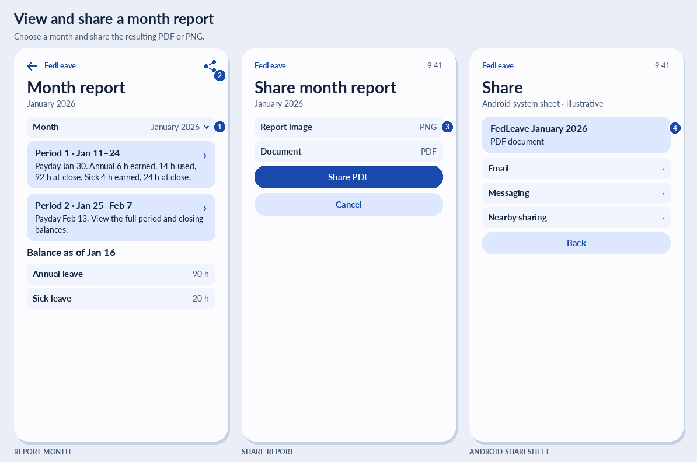

| Callout | Interaction and states | Requirements |
| --- | --- | --- |
| 1–2 | Show a zoomable preview of the desktop month report and put Share in the upper right. The month report can offer PDF and PNG. The Calendar main-screen shortcut shares the month PDF directly. [Calendar PDF flow](../01-calendar/01-05-menu-and-pdf.md#share-the-displayed-month) | `REP-MONTH-01`, `CAL-SHARE-01` |
| 3–4 | Choose a supported format and hand off the rendered report to Android. Report preparation failure leaves its preview open and offers Retry. Back or cancellation returns to the report and its current filters. | `REP-SHARE-01`, `REP-MONTH-01` |

Rebuild the images with `python android/specification/artwork/mockups/render.py android/specification/artwork/mockups/reports.json`. The chart examples are fictional records and fixed-date specification fixtures.
