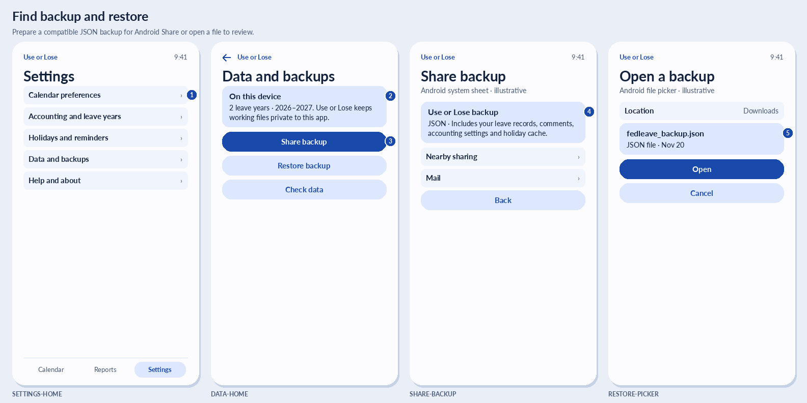
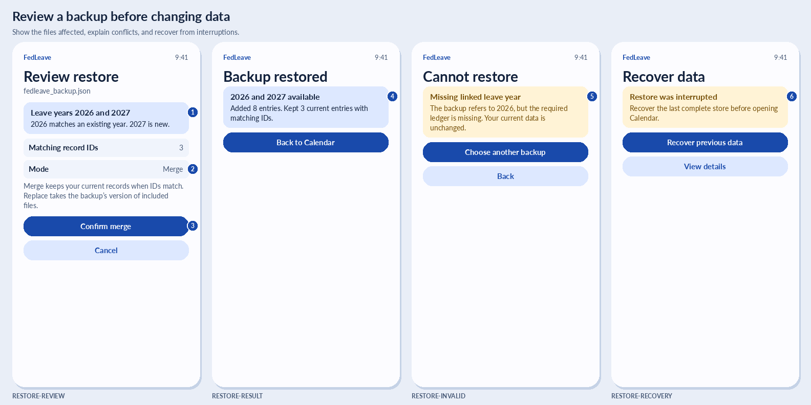
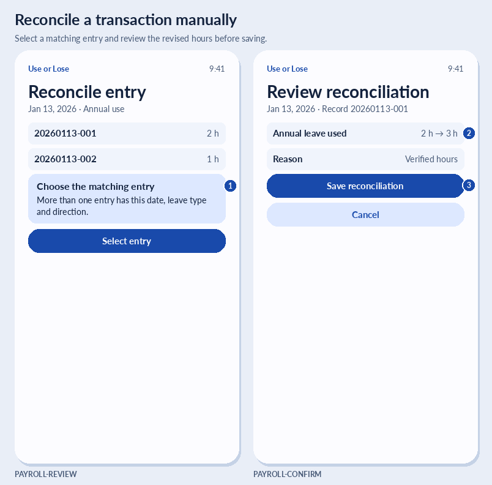
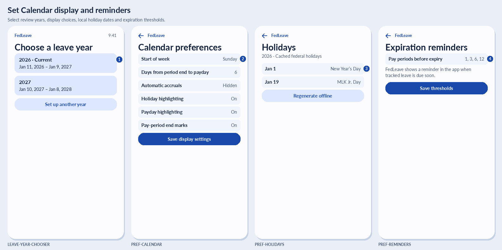
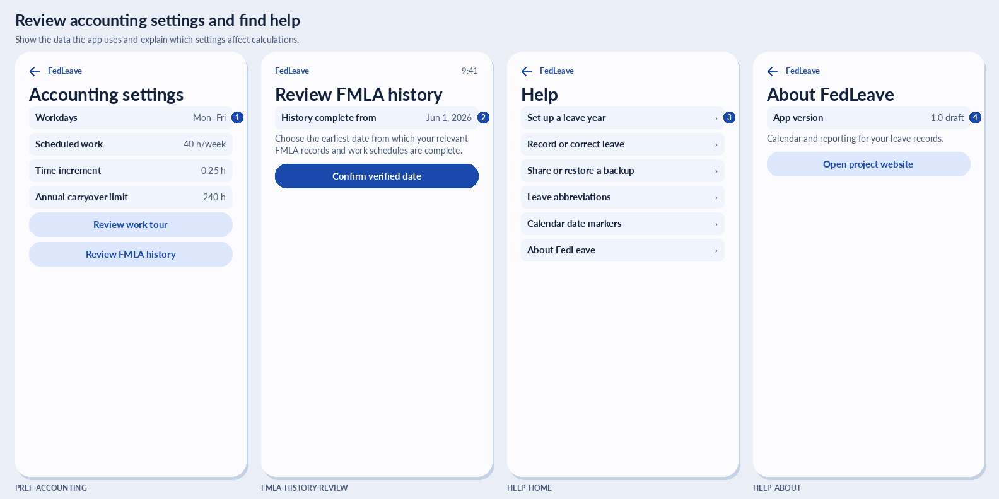
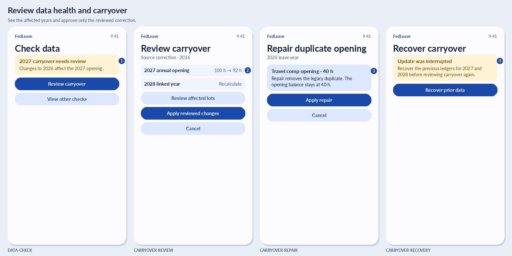
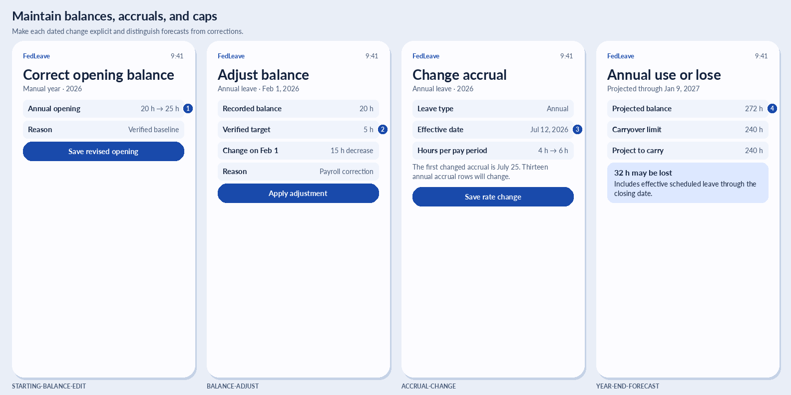
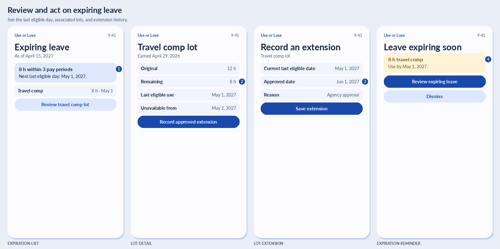
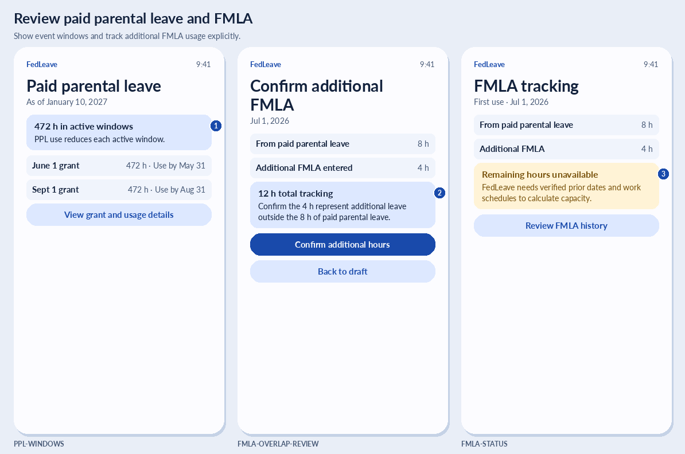

# Chapter 03.03 · Data, maintenance, and settings screens

Settings groups week and display preferences, leave-year maintenance, holiday and reminder controls, data and backups, and help. Routes from Calendar or Reports open the relevant detail and return to the calling task. Show record changes before approving them. Device-owned pickers and Sharesheets are illustrative in the mockups.

[Exact Settings and Help paths](../01-calendar/01-07-menu-structure.md#settings-and-help) · [Data and preference requirements](03-01-reports-data-and-preferences.md#data-and-maintenance) · [Ledger requirements](../02-ledger/02-01-ledger-and-leave-years.md) · [Acceptance cases](../../verification/acceptance-tests.md#data-and-preferences-acceptance)

## Backups and system file picker

| Callout | Interaction and states | Requirements |
| --- | --- | --- |
| 1–3 | Open Settings, then Data and backups. Show which years are on this phone and make Share backup and Restore backup easy to find. Shared backups include ledger data and comments. Report preparation status and allow retry after error. | `DATA-SHARE-01`, `DATA-RESTORE-01` |
| 4–5 | Hand the prepared backup to Android Share. For restore open Android's file picker. Dismissing either returns to the caller, with the active store intact. | `DATA-SHARE-01`, `DATA-RESTORE-01` |

## Restore review and recovery

| Callout | Interaction and states | Requirements |
| --- | --- | --- |
| 1–3 | Show the source filename, candidate years, record collisions and affected settings and caches for the selected mode. A failed validation disables confirmation. Confirm changes only from a current, complete preview. | `DATA-RESTORE-01` |
| 4–6 | Show applied or retained record counts on success, a cause and another-picker action on rejection, and a recovery action after interruption. Restore from first launch returns to Calendar after success. Recovery takes priority over displaying incomplete data. | `DATA-RESTORE-01` |

## Manual payroll review

This workflow is for correcting or marking one existing ledger entry as verified after you compare it with a timecard or pay statement you have open elsewhere. You read the payroll record yourself and type the verified hours. The app uses only the entries already saved in Use or Lose. It does not import statements, find payroll discrepancies automatically, or reconcile an entire pay period.

The example shows two separate annual leave entries on January 13. Entry `20260113-001` records 2 h and entry `20260113-002` records 1 h. If your payroll record says the first entry should be 3 h, select `20260113-001`, enter **3 h** and give the reason. The review shows **2 h → 3 h** on that one record. After confirmation, that ID records 3 h and is marked reconciled, with your explanation. The second entry stays at 1 h. Total annual leave used that day changes from 3 h to 4 h, which reduces the dated annual balance by another hour.

| Callout | What the screen shows |
| --- | --- |
| 1 | Open **Reconcile entry** from a transaction or day. When several entries share the selected date, leave type and direction, the list shows their individual IDs and recorded hours. Choose the one you can identify in your own records. |
| 2 | Enter the exact verified hours and reason. The review shows the chosen date, leave type, record ID and a before-and-after comparison. |
| 3 | **Save reconciliation** updates the selected row in place and marks it reconciled. The save keeps the record ID and the other entries. Cancel returns to the caller without changing the ledger. |

**Decision for review.** Keep **Reconcile entry** as a dedicated action if payroll verification is a recurring task and the reconciled status helps you distinguish entries you checked. If the useful part is changing the hours on a known entry, **Correct entry** already covers that job. Use **Force Balance** when you trust the total on a date and want one adjustment while keeping the original entries. [Ordinary correction](../02-ledger/02-01-ledger-and-leave-years.md#edit-and-review-leave) · [Force Balance](../01-calendar/01-06-force-balance.md) · [Desktop reconciliation behavior](../../../../src/useorlose/commands/transactions.py#L456)

## Calendar, holidays, and reminders

| Callout | Interaction and states | Requirements |
| --- | --- | --- |
| 1–2 | Show actual year bounds in the chooser. Apply Calendar display choices without changing calculation dates. Respect larger system fonts and retain period-end labels in the balance picker. | `PREF-YEAR-01`, `PREF-CAL-01` |
| 3–4 | List locally cached observed holiday dates and their source. Offer offline regeneration and preserve the readable cache if it fails. Keep nonnegative, distinct reminder thresholds in pay periods. | `PREF-HOL-01`, `PREF-REM-01` |

## Accounting settings and help

| Callout | Interaction and states | Requirements |
| --- | --- | --- |
| 1–2 | Show accounting rules in use. Review changes that influence balances and verify a history start before displaying remaining FMLA hours as known. | `PREF-RULE-01`, `PARENT-02` |
| 3–4 | Group bundled help by user task, with a leave abbreviation list. About gives version and an external project link. | `HELP-01` |

### Calendar date markers in Help

| Callout | Meaning |
| --- | --- |
| 1 | **Holiday** identifies the applicable holiday date. |
| 2 | **Payday** identifies the scheduled payday. |
| 3 | **Pay-period end** identifies the last day of a pay period. |
| 4 | **Leave-year end** identifies the last day of the leave year. |

Open this page from **Settings → Help and about → Calendar date markers**. Show the glyphs beside the text and read the full descriptions in TalkBack. Back returns to Help. [Bundled legend copy](../../help/calendar-date-markers.md) · [Exact marker artwork](../01-calendar/01-04-date-markers.md#marker-artwork-at-calendar-size)

## Data check, carryover and repair

| Callout | Interaction and states | Requirements |
| --- | --- | --- |
| 1–2 | Check data on demand and identify affected years. Review old and new openings, lots and missing-source conflicts before acknowledging a new result. A stale review reloads and reconfirms. | `DATA-VALIDATE-01`, `YEAR-REC-01` |
| 3–4 | Repair a known legacy mirror explicitly. Interrupted carryover updates open recovery before a new review or other ledger edit. | `DATA-REPAIR-01`, `YEAR-REC-01` |

## Opening balance, balance adjustment, and accrual

| Callout | Interaction and states | Requirements |
| --- | --- | --- |
| 1 | Compare old and revised opening in an independent year. A linked year routes to source or carryover review. | `YEAR-OPEN-01` |
| 2 | **Force Balance** opens the same dated form and review as the Calendar menu. [Force Balance screens](../01-calendar/01-06-force-balance.md) | `CAL-FORCE-01` |
| 3 | Choose an effective date and annual or sick accrual rate. Review the effective date, applicable hours, and reason. Keep the draft on failure. | `YEAR-ACC-01` |
| 4 | Read the dedicated use-or-lose calculation with its forecast close, carryover cap and excess. It does not alter the data. | `YEAR-CAP-01` |

## Expiration and approved deadlines

| Callout | Interaction and states | Requirements |
| --- | --- | --- |
| 1–2 | Show upcoming hours and dates. The lot view adds source identity, original quantity, used hours or allocations, extension history and the first ineligible date. An empty list states there are no upcoming deadlines. | `EXP-01` |
| 3–4 | Record a permitted later approved deadline and reason. The urgency reminder deep-links to expiration details and observes local thresholds. | `EXP-01`, `EXP-02`, `PREF-REM-01` |

## PPL windows and FMLA tracking

| Callout | Interaction and states | Requirements |
| --- | --- | --- |
| 1 | Each grant and use is dated. Show the remaining allowance across active windows and the original deadlines. Expand to review totals, protected hours and lost hours by date range. The [day editor](../01-calendar/01-03-navigation-and-screens.md#add-and-review-leave) records the grants and usage. | `PARENT-01` |
| 2–3 | Ask separately about additional manual FMLA. Show derived and additional hours, confirmed or provisional date context, and availability or an explanation when records are incomplete. | `PARENT-02` |

Rebuild the images with `python android/specification/artwork/mockups/render.py android/specification/artwork/mockups/settings.json`.
